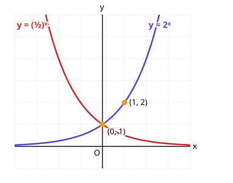
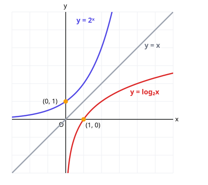

# 3. 지수함수와 로그함수

> **먼저 알아야 할 것**: [2. 로그](02-logarithms.md), [공통수학2 7. 역함수](../common2/07-functions.md)
>
> **한 줄 요약**: $y = a^x$는 폭발적으로 커지는 그래프, $y = \log_a x$는 그 역함수라서 $y = x$에 대칭입니다.

## 지수함수 $y = a^x$

종이를 반으로 접을 때마다 두께는 2배가 됩니다. 접은 횟수를 $x$라 하면 두께는 $2^x$배. 이렇게 **일정한 비율로 곱해지며 늘어나는** 것을 나타내는 함수가 지수함수입니다.

$$
y = a^x \quad (a > 0,\; a \neq 1)
$$

### 성질

- 정의역: 실수 전체
- 치역: $y > 0$ (양수만 나옴)
- 항상 점 $(0, 1)$을 지남 ($a^0 = 1$)
- 점근선: $x$축 ($y = 0$)
- $a > 1$이면 **증가** ($x$가 커지면 $y$도 커짐), $0 < a < 1$이면 **감소**

> 💡 $y = \left(\dfrac{1}{2}\right)^x = 2^{-x}$이므로, $y = 2^x$를 $y$축에 대칭이동한 것입니다.

## 로그함수 $y = \log_a x$

$y = a^x$를 $x$에 대해 풀면 $x = \log_a y$. $x$와 $y$를 바꾸면 $y = \log_a x$. 즉 **로그함수는 지수함수의 역함수**입니다.

### 성질 (지수함수와 $x$, $y$가 뒤바뀜)

- 정의역: $x > 0$ (진수는 양수)
- 치역: 실수 전체
- 항상 점 $(1, 0)$을 지남 ($\log_a 1 = 0$)
- 점근선: $y$축 ($x = 0$)
- $a > 1$이면 증가, $0 < a < 1$이면 감소

| | $y = a^x$ | $y = \log_a x$ |
|---|---|---|
| 정의역 | 실수 전체 | $x > 0$ |
| 치역 | $y > 0$ | 실수 전체 |
| 지나는 점 | $(0, 1)$ | $(1, 0)$ |
| 점근선 | $x$축 | $y$축 |

## 평행이동

이차함수와 똑같습니다.

- $y = a^{x - m} + n$: 점근선 $y = n$
- $y = \log_a (x - m) + n$: 점근선 $x = m$, 정의역 $x > m$

## 크기 비교

**밑이 1보다 크면** 지수(또는 진수)가 클수록 큽니다. **밑이 1보다 작으면** 반대예요.

- $2^{3} < 2^{5}$ (밑 2 > 1)
- $\left(\dfrac{1}{2}\right)^{3} > \left(\dfrac{1}{2}\right)^{5}$ (밑 $\frac{1}{2}$ < 1, 방향 반대)

## 지수방정식과 로그방정식

**지수방정식**: 밑을 같게 만들어서 지수끼리 비교

$$
4^x = 8 \;\Rightarrow\; 2^{2x} = 2^3 \;\Rightarrow\; 2x = 3 \;\Rightarrow\; x = \frac{3}{2}
$$

**로그방정식**: 로그를 없애서 진수끼리 비교. **진수 조건 (진수 > 0)** 확인 필수!

$$
\log_2 (x + 1) = 3 \;\Rightarrow\; x + 1 = 2^3 \;\Rightarrow\; x = 7
$$

진수 $x + 1 = 8 > 0$ ✔

## 지수부등식과 로그부등식

밑이 1보다 크면 부등호 방향 그대로, **1보다 작으면 방향을 뒤집습니다.**

- $2^x > 8$ → $2^x > 2^3$ → $x > 3$
- $\left(\dfrac{1}{3}\right)^x > 9$ → $\left(\dfrac{1}{3}\right)^x > \left(\dfrac{1}{3}\right)^{-2}$ → $x < -2$ (방향 뒤집힘)
- $\log_2 x < 3$ → $0 < x < 8$ (진수 조건 $x > 0$ 포함)

## 예제

**예제 1.** $y = 3^{x - 2} + 1$의 점근선과 지나는 점 하나는?

> 풀이: 점근선 $y = 1$. $x = 2$일 때 $y = 3^0 + 1 = 2$ → 점 $(2, 2)$

**예제 2.** $9^x = 27$을 푸세요.

> 풀이: $3^{2x} = 3^3$ → $x = \dfrac{3}{2}$

**예제 3.** $\log_3 x + \log_3 (x - 2) = 1$

> 풀이: 진수 조건: $x > 0$, $x - 2 > 0$ → $x > 2$
>
> $\log_3 x(x - 2) = 1$ → $x^2 - 2x = 3$ → $(x - 3)(x + 1) = 0$
>
> 진수 조건에 맞는 것은 $x = 3$

## 연습문제

1. $y = 5^x$의 그래프가 반드시 지나는 점과 점근선
2. $y = \log_2 (x + 3)$의 정의역과 점근선
3. $2^{x + 1} = 32$
4. $8^x = 4$
5. $\log_5 (2x - 1) = 2$
6. $3^x \le 81$
7. $\left(\dfrac{1}{2}\right)^x < 4$
8. 세 수 $2^{0.5}$, $2^{-1}$, $2^{2}$의 크기 비교

## 정답과 풀이

1. $(0, 1)$, $y = 0$
2. $x > -3$, $x = -3$
3. $x = 4$ ($x + 1 = 5$)
4. $x = \dfrac{2}{3}$ ($2^{3x} = 2^2$)
5. $x = 13$ ($2x - 1 = 25$)
6. $x \le 4$
7. $x > -2$ ($\left(\frac{1}{2}\right)^x < \left(\frac{1}{2}\right)^{-2}$, 밑 < 1이라 방향 뒤집기)
8. $2^{-1} < 2^{0.5} < 2^{2}$

---

이전 단원: [2. 로그](02-logarithms.md) · 다음 단원: [4. 삼각함수](04-trigonometry.md)
