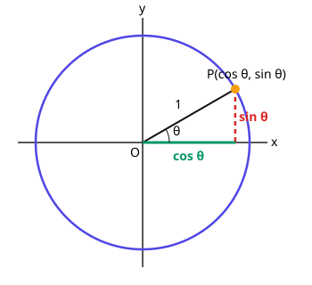
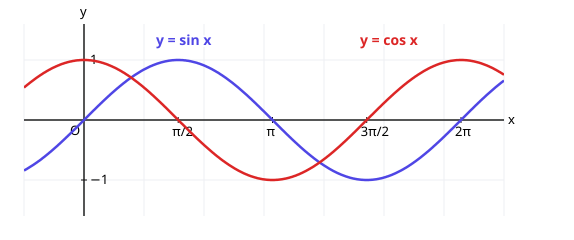
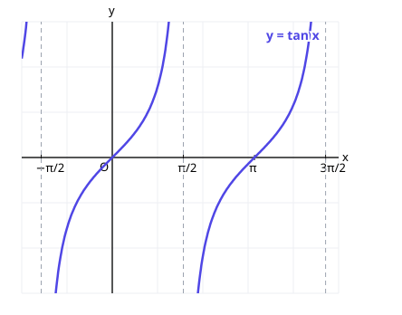

# 4. 삼각함수

> **먼저 알아야 할 것**: [공통수학2 3. 원의 방정식](../common2/03-circles.md), 중학교의 직각삼각형과 피타고라스 정리
>
> **한 줄 요약**: 반지름 1인 원 위를 도는 점의 **$x$좌표가 $\cos$, $y$좌표가 $\sin$** 입니다.

수포자들이 가장 겁내는 단원이지만, 원 하나만 그릴 줄 알면 거의 모든 것을 그림으로 이해할 수 있습니다.

## 1. 호도법: 각을 길이로 재기

지금까지 각은 도($^\circ$)로 쟀습니다. 고등학교에서는 **라디안**이라는 단위를 씁니다.

반지름이 1인 원에서 **호의 길이가 1이 되는 각**을 1라디안이라고 합니다. 원 한 바퀴의 둘레는 $2\pi$이므로

$$
360^\circ = 2\pi, \qquad 180^\circ = \pi
$$

| 도 | $30^\circ$ | $45^\circ$ | $60^\circ$ | $90^\circ$ | $180^\circ$ | $360^\circ$ |
|---|---|---|---|---|---|---|
| 라디안 | $\dfrac{\pi}{6}$ | $\dfrac{\pi}{4}$ | $\dfrac{\pi}{3}$ | $\dfrac{\pi}{2}$ | $\pi$ | $2\pi$ |

> 💡 **"$\pi = 180^\circ$"** 하나만 기억하면 나머지는 나누기로 구할 수 있습니다. $\dfrac{\pi}{6} = \dfrac{180^\circ}{6} = 30^\circ$

반지름 $r$, 중심각 $\theta$(라디안)인 부채꼴의 호의 길이는 $l = r\theta$, 넓이는 $S = \dfrac{1}{2}r^2\theta$입니다.

## 2. 삼각함수의 정의: 단위원

반지름이 1인 원(**단위원**) 위에서 $x$축 양의 방향으로부터 각 $\theta$만큼 돌아간 점을 $P$라고 하면

$$
\cos\theta = P\text{의 } x\text{좌표}, \qquad \sin\theta = P\text{의 } y\text{좌표}, \qquad \tan\theta = \frac{\sin\theta}{\cos\theta}
$$

> 💡 **cos는 가로(x), sin은 세로(y).** 알파벳 순서대로 c → x, s → y라고 외워도 됩니다.

$\tan\theta$는 원점과 $P$를 잇는 선의 **기울기**입니다.

### 꼭 알아야 할 값

직각삼각형 두 개(정삼각형의 절반, 직각이등변삼각형)에서 나오는 값입니다.

| $\theta$ | $0$ | $\dfrac{\pi}{6}$ | $\dfrac{\pi}{4}$ | $\dfrac{\pi}{3}$ | $\dfrac{\pi}{2}$ |
|---|---|---|---|---|---|
| $\sin\theta$ | $0$ | $\dfrac{1}{2}$ | $\dfrac{\sqrt{2}}{2}$ | $\dfrac{\sqrt{3}}{2}$ | $1$ |
| $\cos\theta$ | $1$ | $\dfrac{\sqrt{3}}{2}$ | $\dfrac{\sqrt{2}}{2}$ | $\dfrac{1}{2}$ | $0$ |
| $\tan\theta$ | $0$ | $\dfrac{\sqrt{3}}{3}$ | $1$ | $\sqrt{3}$ | 없음 |

> 💡 $\sin$ 줄은 $\dfrac{\sqrt{0}}{2}, \dfrac{\sqrt{1}}{2}, \dfrac{\sqrt{2}}{2}, \dfrac{\sqrt{3}}{2}, \dfrac{\sqrt{4}}{2}$로 루트 안이 0부터 4까지 늘어납니다. $\cos$ 줄은 그 반대 순서예요.

### 사분면별 부호

점 $P$가 어느 사분면에 있느냐에 따라 좌표의 부호가 정해지므로

| | 1사분면 | 2사분면 | 3사분면 | 4사분면 |
|---|---|---|---|---|
| 양수인 것 | 모두 | $\sin$ | $\tan$ | $\cos$ |

> 💡 "**얼(All)–싸(sin)–안(tan)–코(cos)**"로 외웁니다.

## 3. 삼각함수 사이의 관계

점 $P(\cos\theta, \sin\theta)$는 반지름 1인 원 위에 있으므로 $x^2 + y^2 = 1$에서

$$
\sin^2\theta + \cos^2\theta = 1
$$

**예)** $\sin\theta = \dfrac{3}{5}$이고 $\theta$가 2사분면의 각일 때 $\cos\theta$는?

$\cos^2\theta = 1 - \dfrac{9}{25} = \dfrac{16}{25}$, 2사분면이면 $\cos < 0$ → $\cos\theta = -\dfrac{4}{5}$

## 4. 여러 각의 삼각함수

원을 생각하면 외울 필요가 없습니다.

- **한 바퀴 더 돌면 제자리**: $\sin(\theta + 2\pi) = \sin\theta$, $\cos(\theta + 2\pi) = \cos\theta$
- **반대 방향($-\theta$)**: $x$축 대칭 → $\sin(-\theta) = -\sin\theta$, $\cos(-\theta) = \cos\theta$
- **반 바퀴($\pi + \theta$)**: 원점 대칭 → $\sin(\pi + \theta) = -\sin\theta$, $\cos(\pi + \theta) = -\cos\theta$
- **$\pi - \theta$**: $y$축 대칭 → $\sin(\pi - \theta) = \sin\theta$, $\cos(\pi - \theta) = -\cos\theta$

예) $\sin\dfrac{5\pi}{6} = \sin\left(\pi - \dfrac{\pi}{6}\right) = \sin\dfrac{\pi}{6} = \dfrac{1}{2}$

## 5. 삼각함수의 그래프

점 $P$가 원을 계속 돌면 $y$좌표($\sin$)는 $-1$과 $1$ 사이를 오르내리며 **물결 모양**을 그립니다.

| | $y = \sin x$ | $y = \cos x$ | $y = \tan x$ |
|---|---|---|---|
| 치역 | $-1 \le y \le 1$ | $-1 \le y \le 1$ | 실수 전체 |
| 주기 | $2\pi$ | $2\pi$ | $\pi$ |
| 대칭 | 원점 대칭 | $y$축 대칭 | 원점 대칭 |

$y = \tan x$는 $\cos x = 0$인 $x = \dfrac{\pi}{2} + n\pi$에서 정의되지 않고, 그 직선들이 점근선이 됩니다.

### $y = a\sin(bx) + c$

- $|a|$: 위아래로 늘이기 → 최댓값 $|a| + c$, 최솟값 $-|a| + c$
- $b$: 주기를 $\dfrac{2\pi}{|b|}$로 바꿈
- $c$: 위아래 평행이동

예) $y = 3\sin 2x + 1$: 최댓값 $4$, 최솟값 $-2$, 주기 $\pi$

## 6. 사인법칙과 코사인법칙 (맛보기)

삼각형 $ABC$에서 각 $A, B, C$의 대변의 길이를 $a, b, c$, 외접원의 반지름을 $R$이라 하면

- **사인법칙**: $\dfrac{a}{\sin A} = \dfrac{b}{\sin B} = \dfrac{c}{\sin C} = 2R$
- **코사인법칙**: $a^2 = b^2 + c^2 - 2bc\cos A$ (피타고라스 정리의 확장. $A = 90^\circ$이면 $\cos A = 0$이 되어 피타고라스 정리)
- **넓이**: $S = \dfrac{1}{2}bc\sin A$

## 예제

**예제 1.** $120^\circ$를 라디안으로, $\dfrac{3\pi}{4}$를 도로 바꾸세요.

> 풀이: $120^\circ = \dfrac{120}{180}\pi = \dfrac{2\pi}{3}$, $\dfrac{3\pi}{4} = \dfrac{3 \times 180^\circ}{4} = 135^\circ$

**예제 2.** $\cos\dfrac{2\pi}{3}$의 값은?

> 풀이: $\cos\left(\pi - \dfrac{\pi}{3}\right) = -\cos\dfrac{\pi}{3} = -\dfrac{1}{2}$

**예제 3.** 삼각형에서 $b = 3$, $c = 5$, $A = \dfrac{\pi}{3}$일 때 $a$는?

> 풀이: $a^2 = 9 + 25 - 2 \cdot 3 \cdot 5 \cdot \dfrac{1}{2} = 19$ → $a = \sqrt{19}$

## 연습문제

1. $45^\circ$, $270^\circ$를 라디안으로
2. $\sin\dfrac{\pi}{3}$, $\cos\dfrac{\pi}{4}$, $\tan\dfrac{\pi}{6}$
3. $\sin\left(-\dfrac{\pi}{6}\right)$, $\cos\pi$
4. $\theta$가 3사분면의 각이면 $\sin\theta$, $\cos\theta$, $\tan\theta$의 부호는?
5. $\cos\theta = \dfrac{1}{3}$이고 $\theta$가 4사분면의 각일 때 $\sin\theta$
6. $y = 2\cos x - 1$의 최댓값, 최솟값, 주기
7. $y = \sin 3x$의 주기
8. 두 변이 $4$, $6$이고 끼인각이 $\dfrac{\pi}{6}$인 삼각형의 넓이

## 정답과 풀이

1. $\dfrac{\pi}{4}$, $\dfrac{3\pi}{2}$
2. $\dfrac{\sqrt{3}}{2}$, $\dfrac{\sqrt{2}}{2}$, $\dfrac{\sqrt{3}}{3}$
3. $-\dfrac{1}{2}$, $-1$
4. $\sin < 0$, $\cos < 0$, $\tan > 0$
5. $-\dfrac{2\sqrt{2}}{3}$ ($\sin^2\theta = \dfrac{8}{9}$, 4사분면이므로 음수)
6. 최댓값 $1$, 최솟값 $-3$, 주기 $2\pi$
7. $\dfrac{2\pi}{3}$
8. $6$ ($\dfrac{1}{2} \cdot 4 \cdot 6 \cdot \dfrac{1}{2}$)

---

이전 단원: [3. 지수함수와 로그함수](03-exp-log-functions.md) · 다음 단원: [5. 등차수열과 등비수열](05-sequences.md)
