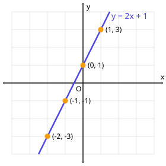

# 4. 함수가 뭐예요?

> **먼저 알아야 할 것**: [3. 일차방정식 풀기](03-linear-equations.md)
>
> **한 줄 요약**: 함수는 숫자를 넣으면 **정확히 하나의** 숫자가 나오는 기계입니다.

고등 수학의 절반 이상이 함수 이야기입니다. 이차함수, 지수함수, 삼각함수, 미분, 적분... 모두 함수를 다룹니다. 그러니 여기서 "함수가 무엇인지" 확실히 잡고 가면 앞으로가 훨씬 편해집니다.

## 함수는 자판기예요

자판기에 1번 버튼을 누르면 콜라가 나오고, 2번을 누르면 사이다가 나옵니다. 1번을 누를 때마다 항상 콜라가 나와야 정상이지요. 1번을 눌렀는데 어떤 날은 콜라, 어떤 날은 사이다가 나온다면 고장 난 자판기입니다.

함수도 똑같습니다.

- **넣는 값** $x$ 하나에 **나오는 값** $y$가 **딱 하나**로 정해지면 → $y$는 $x$의 함수

## 함수를 쓰는 방법

"넣은 값에 2를 곱하고 1을 더해서 내보내는 기계"를 식으로 쓰면

$$
y = 2x + 1
$$

이 기계에 이름 $f$를 붙이면

$$
f(x) = 2x + 1
$$

이라고 씁니다. $f(x)$는 "$f$라는 기계에 $x$를 넣었을 때 나오는 값"이라고 읽습니다. ($f$ 곱하기 $x$가 아닙니다!)

## 함숫값 구하기

$f(x) = 2x + 1$일 때

$$
f(3) = 2 \times 3 + 1 = 7
$$

$$
f(-2) = 2 \times (-2) + 1 = -3
$$

$f(3)$은 "기계에 3을 넣었더니 7이 나왔다"는 뜻입니다. 상자 $x$ 자리에 숫자를 넣기만 하면 됩니다.

## 표와 그래프로 보기

$f(x) = 2x + 1$에 여러 값을 넣어 표를 만들어 봅니다.

| $x$ | $-2$ | $-1$ | $0$ | $1$ | $2$ |
|---|---|---|---|---|---|
| $y = f(x)$ | $-3$ | $-1$ | $1$ | $3$ | $5$ |

이 짝 $(x, y)$를 좌표평면에 점으로 찍어 이으면 **직선**이 됩니다. 이것이 함수의 **그래프**입니다. (그림에는 칸 안에 들어오는 점만 표시했어요.)

> 💡 그래프는 "모든 $(x, f(x))$ 짝을 점으로 찍어 놓은 그림"입니다. 그래프 위의 점 하나하나가 "이걸 넣으면 이게 나온다"는 정보입니다.

## 일차함수 $y = ax + b$

$y = 2x + 1$처럼 $x$의 1차식으로 된 함수를 **일차함수**라고 합니다. 그래프는 항상 직선입니다.

- $a$: **기울기**. $x$가 1 늘 때 $y$가 얼마나 느는지. 위 예에서 $x$가 1 늘면 $y$는 2씩 늡니다.
- $b$: **$y$절편**. $x = 0$일 때의 값, 즉 그래프가 $y$축과 만나는 높이.

| 기울기 $a$ | 그래프 모양 |
|---|---|
| $a > 0$ | 오른쪽 위로 올라감 ↗ |
| $a < 0$ | 오른쪽 아래로 내려감 ↘ |
| $a = 0$ | 수평선 → |

## 함수가 아닌 경우

"$x$의 약수를 $y$라 하자"는 함수일까요?

$x = 4$를 넣으면 $y$는 1, 2, 4 세 개가 나옵니다. 하나를 넣었는데 여러 개가 나오므로 **함수가 아닙니다.**

## 예제

**예제 1.** $f(x) = -3x + 5$일 때 $f(2) + f(-1)$의 값은?

> 풀이: $f(2) = -6 + 5 = -1$, $f(-1) = 3 + 5 = 8$이므로 합은 $7$

**예제 2.** 일차함수 $f(x) = ax + 1$에서 $f(2) = 7$일 때 $a$의 값은?

> 풀이: $f(2) = 2a + 1 = 7$이므로 $2a = 6$, $a = 3$
>
> 함수 문제가 결국 [일차방정식](03-linear-equations.md) 문제로 바뀌었습니다!

**예제 3.** 기울기가 $-2$이고 $y$절편이 $4$인 일차함수의 식은?

> 풀이: $y = -2x + 4$

## 연습문제

1. $f(x) = 4x - 3$일 때 $f(0)$, $f(2)$, $f(-1)$을 구하세요.
2. $f(x) = x^2 - 1$일 때 $f(3)$과 $f(-3)$을 구하세요.
3. $y = -x + 2$의 기울기와 $y$절편을 말하세요.
4. $f(x) = 3x + b$이고 $f(1) = 5$일 때 $b$를 구하세요.
5. 다음 중 $y$가 $x$의 함수인 것을 모두 고르세요.
   - (가) 자연수 $x$보다 작은 자연수 $y$
   - (나) 한 개에 500원인 과자 $x$개의 값 $y$원
   - (다) 한 변의 길이가 $x$인 정사각형의 넓이 $y$
6. 일차함수의 그래프가 두 점 $(0, 1)$, $(2, 7)$을 지날 때 식을 구하세요.

## 정답과 풀이

1. $f(0) = -3$, $f(2) = 5$, $f(-1) = -7$
2. 둘 다 $8$ ($(-3)^2 = 9$에 주의)
3. 기울기 $-1$, $y$절편 $2$
4. $b = 2$ ($3 + b = 5$)
5. (나), (다). (가)는 $x = 3$이면 $y$가 1, 2 두 개라서 함수가 아닙니다. ($y = 500x$, $y = x^2$)
6. $y = 3x + 1$ ($y$절편이 1이고, $x$가 2 늘 때 $y$가 6 늘었으므로 기울기는 $6 \div 2 = 3$)

---

이전 단원: [3. 일차방정식 풀기](03-linear-equations.md) · 다음 단원: [5. 연립방정식](05-systems.md)
