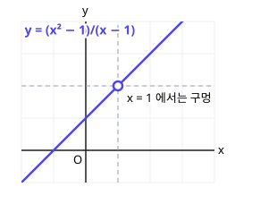
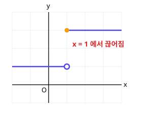

# 1. 함수의 극한

> **먼저 알아야 할 것**: [공통수학2 8. 유리함수](../common2/08-rational-irrational-functions.md), [공통수학1 4. 인수분해](../common1/04-factoring.md)
>
> **한 줄 요약**: 극한은 "$x$가 어떤 값에 **한없이 가까워질 때** $f(x)$는 어디로 가까워지나?"를 묻는 것입니다.

미적분은 고등 수학의 꽃이지만, 출발점은 "가까워진다"는 단순한 생각 하나입니다.

## 왜 "가까워진다"가 필요할까?

$$
f(x) = \frac{x^2 - 1}{x - 1}
$$

$x = 1$을 넣으면 $\dfrac{0}{0}$이 되어 계산할 수 없습니다. 하지만 1에 **아주 가까운** 값을 넣어 보면

| $x$ | $0.9$ | $0.99$ | $0.999$ | $1$ | $1.001$ | $1.01$ | $1.1$ |
|---|---|---|---|---|---|---|---|
| $f(x)$ | $1.9$ | $1.99$ | $1.999$ | ? | $2.001$ | $2.01$ | $2.1$ |

$x$가 1에 가까워질수록 $f(x)$는 **2에 가까워집니다**. 이것을

$$
\lim_{x \to 1} \frac{x^2 - 1}{x - 1} = 2
$$

라고 쓰고, "$x$가 1로 갈 때 $f(x)$의 **극한값**은 2"라고 읽습니다.

그래프로 보면 $y = x + 1$ 직선에서 $x = 1$인 점만 **구멍**이 뚫려 있습니다. 구멍이 있어도 그 주변이 향하는 곳은 분명히 $2$예요.

> 💡 극한은 "$x = a$**에서의** 값"이 아니라 "$x = a$ **근처에서** 향하는 값"입니다. $f(a)$가 없어도 극한값은 있을 수 있어요.

## 좌극한과 우극한

$x$가 $a$로 갈 때 **왼쪽에서** 다가가는 것($x \to a-$)과 **오른쪽에서** 다가가는 것($x \to a+$)을 따로 볼 수 있습니다.

$$
\lim_{x \to a} f(x) = L \iff \lim_{x \to a-} f(x) = \lim_{x \to a+} f(x) = L
$$

양쪽에서 같은 곳으로 가야 극한값이 존재합니다. 다르면 **극한값이 없다**고 해요.

위 그래프에서 $x \to 1-$이면 $1$, $x \to 1+$이면 $3$으로 다르므로 $\displaystyle\lim_{x \to 1} f(x)$는 존재하지 않습니다.

## 극한값 계산하기

### 1. 그냥 넣어도 되면 넣는다

다항함수처럼 끊김 없는 함수는 그냥 대입하면 됩니다.

$$
\lim_{x \to 2} (x^2 + 3x) = 4 + 6 = 10
$$

### 2. $\dfrac{0}{0}$ 꼴이면 인수분해해서 약분

$$
\lim_{x \to 2} \frac{x^2 - 4}{x - 2} = \lim_{x \to 2} \frac{(x + 2)(x - 2)}{x - 2} = \lim_{x \to 2} (x + 2) = 4
$$

$x \to 2$는 $x \neq 2$인 상태로 가까워지는 것이라 $x - 2 \neq 0$이므로 약분할 수 있습니다.

### 3. 루트가 있는 $\dfrac{0}{0}$ 꼴은 유리화

$$
\lim_{x \to 0} \frac{\sqrt{x + 1} - 1}{x} = \lim_{x \to 0} \frac{(x + 1) - 1}{x(\sqrt{x + 1} + 1)} = \lim_{x \to 0} \frac{1}{\sqrt{x + 1} + 1} = \frac{1}{2}
$$

### 4. $x \to \infty$이면 최고차항끼리 비교

$x$가 한없이 커질 때($x \to \infty$)는 **가장 높은 차수**가 결과를 결정합니다. 분모의 최고차항으로 위아래를 나누세요.

$$
\lim_{x \to \infty} \frac{3x^2 + 1}{x^2 - 5x} = \lim_{x \to \infty} \frac{3 + \frac{1}{x^2}}{1 - \frac{5}{x}} = \frac{3 + 0}{1 - 0} = 3
$$

> 💡 $x \to \infty$일 때 $\dfrac{\text{(분자)}}{\text{(분모)}}$는
>
> - 분자 차수 = 분모 차수 → 최고차항 **계수의 비**
> - 분자 차수 < 분모 차수 → $0$
> - 분자 차수 > 분모 차수 → $\infty$ 또는 $-\infty$ (발산)

## 미정계수 구하기

$$
\lim_{x \to 1} \frac{x^2 + ax + 2}{x - 1} = b
$$

분모가 0으로 가는데 극한값이 있으려면 **분자도 0으로 가야** 합니다. ($\frac{\text{0 아닌 수}}{0}$은 발산하니까요.)

$1 + a + 2 = 0$ → $a = -3$. 그러면 $\dfrac{x^2 - 3x + 2}{x - 1} = \dfrac{(x - 1)(x - 2)}{x - 1}$ → $b = 1 - 2 = -1$

## 예제

**예제 1.** $\displaystyle\lim_{x \to 3} \frac{x^2 - 9}{x - 3}$

> 풀이: $(x + 3)$으로 약분 → $6$

**예제 2.** $\displaystyle\lim_{x \to \infty} \frac{2x + 5}{4x - 1}$

> 풀이: 차수가 같으니 계수의 비 $\dfrac{2}{4} = \dfrac{1}{2}$

**예제 3.** $f(x) = \begin{cases} x + 1 & (x < 0) \\ x^2 & (x \ge 0) \end{cases}$일 때 $\displaystyle\lim_{x \to 0} f(x)$는?

> 풀이: 좌극한 $0 + 1 = 1$, 우극한 $0$ → 다르므로 극한값 없음

## 연습문제

1. $\displaystyle\lim_{x \to -1} (2x^2 - x + 3)$
2. $\displaystyle\lim_{x \to 1} \frac{x^2 + x - 2}{x - 1}$
3. $\displaystyle\lim_{x \to 0} \frac{x^2 + 5x}{x}$
4. $\displaystyle\lim_{x \to 4} \frac{\sqrt{x} - 2}{x - 4}$
5. $\displaystyle\lim_{x \to \infty} \frac{5x^2 - x}{2x^2 + 3}$
6. $\displaystyle\lim_{x \to \infty} \frac{x + 1}{x^2 + 1}$
7. $\displaystyle\lim_{x \to 2} \frac{x^2 + ax - 6}{x - 2} = b$일 때 $a$, $b$

## 정답과 풀이

1. $6$ ($2 + 1 + 3$)
2. $3$ ($(x + 2)$로 약분 → $1 + 2$)
3. $5$ ($x + 5$)
4. $\dfrac{1}{4}$ ($x - 4 = (\sqrt{x} - 2)(\sqrt{x} + 2)$ → $\dfrac{1}{\sqrt{x} + 2}$)
5. $\dfrac{5}{2}$
6. $0$ (분모 차수가 더 큼)
7. $a = 1$, $b = 5$ ($4 + 2a - 6 = 0$ → $a = 1$, $\dfrac{(x + 3)(x - 2)}{x - 2}$ → $5$)

---

이전 단원: [대수 - 7. 수학적 귀납법](../algebra/07-induction.md) · 다음 단원: [2. 함수의 연속](02-continuity.md)
