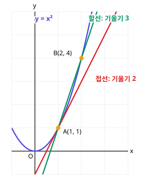

# 3. 미분계수와 도함수

> **먼저 알아야 할 것**: [1. 함수의 극한](01-limits.md), [공통수학2 2. 직선의 방정식](../common2/02-lines.md) (기울기)
>
> **한 줄 요약**: 미분은 **순간의 기울기**(순간 변화율)를 구하는 것이고, $x^n$을 미분하면 $nx^{n-1}$입니다.

## 평균 속도와 순간 속도

서울에서 부산까지 400km를 4시간에 갔다면 **평균 속도**는 시속 100km입니다. 하지만 자동차 계기판에 찍히는 속도는 매 순간 다르지요. 그 **순간의 속도**를 구하는 것이 미분입니다.

## 평균변화율: 두 점을 이은 직선의 기울기

함수 $y = f(x)$에서 $x$가 $a$에서 $b$로 변할 때

$$
\text{평균변화율} = \frac{f(b) - f(a)}{b - a}
$$

이것은 그래프 위의 두 점을 이은 직선(**할선**)의 기울기입니다.

## 미분계수: 순간의 기울기

이제 $b$를 $a$에 **한없이 가깝게** 가져가 봅시다. $b - a = h$라 하면

$$
f'(a) = \lim_{h \to 0} \frac{f(a + h) - f(a)}{h}
$$

이것을 $x = a$에서의 **미분계수**(순간변화율)라고 합니다. 그래프에서는 점 $(a, f(a))$에서의 **접선의 기울기**입니다.

위 그림에서 $y = x^2$ 위의 $A(1, 1)$과 $B(2, 4)$를 이은 할선의 기울기는 $3$입니다. $B$를 $A$에 점점 가까이 가져가면 할선은 접선(빨간 선)이 되고, 기울기는 $2$로 다가갑니다.

**직접 계산해 보면** ($f(x) = x^2$, $a = 1$)

$$
f'(1) = \lim_{h \to 0} \frac{(1 + h)^2 - 1}{h} = \lim_{h \to 0} \frac{2h + h^2}{h} = \lim_{h \to 0} (2 + h) = 2
$$

## 도함수: 기울기를 알려 주는 함수

$x = 1$에서만이 아니라 **모든 $x$에서** 미분계수를 구해 주는 함수를 **도함수** $f'(x)$라고 합니다.

$$
f'(x) = \lim_{h \to 0} \frac{f(x + h) - f(x)}{h}
$$

$f(x) = x^2$이면

$$
f'(x) = \lim_{h \to 0} \frac{(x + h)^2 - x^2}{h} = \lim_{h \to 0} (2x + h) = 2x
$$

그래서 $x = 1$에서 기울기는 $2$, $x = 3$에서는 $6$, $x = -1$에서는 $-2$입니다. 도함수를 구하는 것을 "**미분한다**"고 합니다.

> 💡 기호: $f'(x)$, $y'$, $\dfrac{dy}{dx}$, $\dfrac{d}{dx}f(x)$ 모두 같은 뜻입니다.

## 미분 공식: 이것만 알면 된다

매번 극한을 계산할 필요 없이 공식을 쓰면 됩니다.

$$
(x^n)' = n\,x^{n-1}
$$

> 💡 **지수를 앞으로 내리고, 지수는 1 줄인다.**

| $f(x)$ | $f'(x)$ |
|---|---|
| $c$ (상수) | $0$ |
| $x$ | $1$ |
| $x^2$ | $2x$ |
| $x^3$ | $3x^2$ |
| $x^{10}$ | $10x^9$ |

상수의 미분이 0인 이유: $y = 5$는 수평선이라 기울기가 0이니까요.

### 미분의 성질

$$
\{c\,f(x)\}' = c\,f'(x), \qquad \{f(x) \pm g(x)\}' = f'(x) \pm g'(x)
$$

그래서 다항함수는 **항별로** 미분하면 됩니다.

$$
(3x^4 - 2x^2 + 5x - 7)' = 12x^3 - 4x + 5
$$

### 곱의 미분법

$$
\{f(x)\,g(x)\}' = f'(x)\,g(x) + f(x)\,g'(x)
$$

> 💡 "앞 미분 × 뒤 그대로 + 앞 그대로 × 뒤 미분"

예) $\{(x^2 + 1)(x - 3)\}' = 2x(x - 3) + (x^2 + 1) \cdot 1 = 3x^2 - 6x + 1$

($y = \{f(x)\}^n$이면 $y' = n\{f(x)\}^{n-1} f'(x)$도 자주 씁니다.)

## 미분가능과 연속

$x = a$에서 미분가능하면 (접선이 하나로 정해지면) 반드시 연속입니다. 하지만 거꾸로는 아닙니다.

$y = |x|$는 $x = 0$에서 연속이지만 **뾰족하게 꺾여서** 접선을 하나로 정할 수 없습니다. 왼쪽 기울기 $-1$, 오른쪽 기울기 $1$이 다르니까요. → 미분 불가능

## 예제

**예제 1.** $f(x) = x^2 + 3x$에서 $x$가 $1$에서 $3$까지 변할 때 평균변화율은?

> 풀이: $\dfrac{f(3) - f(1)}{3 - 1} = \dfrac{18 - 4}{2} = 7$

**예제 2.** $f(x) = 2x^3 - x^2 + 4$일 때 $f'(x)$와 $f'(1)$은?

> 풀이: $f'(x) = 6x^2 - 2x$, $f'(1) = 4$

**예제 3.** 곡선 $y = x^2 - 4x$ 위의 점 $(3, -3)$에서 접선의 기울기는?

> 풀이: $y' = 2x - 4$, $x = 3$을 넣으면 $2$

## 연습문제

1. $f(x) = x^3$에서 $x$가 $0$에서 $2$까지 변할 때 평균변화율
2. 정의를 이용해 $f(x) = 3x^2$의 $f'(1)$을 구하세요.
3. $(x^5)'$, $(7)'$, $(4x)'$
4. $f(x) = x^3 - 6x^2 + 9x + 1$의 도함수
5. $f(x) = \dfrac{1}{3}x^3 + 2x^2 - x$일 때 $f'(2)$
6. $y = (2x + 1)(x^2 - 1)$을 미분하세요.
7. $f(x) = x^2 + ax$에서 $f'(1) = 5$일 때 $a$

## 정답과 풀이

1. $4$ ($\dfrac{8 - 0}{2}$)
2. $6$ ($\displaystyle\lim_{h \to 0} \dfrac{3(1 + h)^2 - 3}{h} = \lim_{h \to 0} (6 + 3h)$)
3. $5x^4$, $0$, $4$
4. $3x^2 - 12x + 9$
5. $11$ ($f'(x) = x^2 + 4x - 1$ → $4 + 8 - 1$)
6. $6x^2 + 2x - 2$ ($2(x^2 - 1) + (2x + 1) \cdot 2x$)
7. $a = 3$ ($2 + a = 5$)

---

이전 단원: [2. 함수의 연속](02-continuity.md) · 다음 단원: [4. 도함수의 활용](04-derivative-applications.md)
