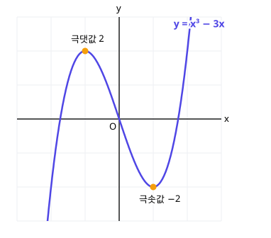

# 4. 도함수의 활용

> **먼저 알아야 할 것**: [3. 미분계수와 도함수](03-derivatives.md)
>
> **한 줄 요약**: $f'(x)$의 부호가 그래프의 오르막(+)과 내리막(−)을 알려 주고, $f'(x) = 0$인 곳에 봉우리와 골짜기가 있습니다.

## 1. 접선의 방정식

곡선 $y = f(x)$ 위의 점 $(a, f(a))$에서의 접선은 기울기가 $f'(a)$이므로, [직선의 방정식](../common2/02-lines.md)에 의해

$$
y - f(a) = f'(a)(x - a)
$$

**예)** $y = x^2$ 위의 점 $(1, 1)$에서의 접선

$f'(1) = 2$ → $y - 1 = 2(x - 1)$ → $y = 2x - 1$

## 2. 증가와 감소

$f'(x)$는 기울기입니다. 그래서

- $f'(x) > 0$인 구간: 그래프가 **올라감** (증가)
- $f'(x) < 0$인 구간: 그래프가 **내려감** (감소)

> 💡 산을 걷는다고 생각하세요. 기울기가 양수면 오르막, 음수면 내리막입니다.

## 3. 극대와 극소

오르막에서 내리막으로 바뀌는 **봉우리**를 **극대**, 내리막에서 오르막으로 바뀌는 **골짜기**를 **극소**라고 합니다. 그 점에서는 접선이 수평이므로 $f'(x) = 0$입니다.

**예)** $f(x) = x^3 - 3x$

$f'(x) = 3x^2 - 3 = 3(x + 1)(x - 1) = 0$ → $x = -1$, $x = 1$

이 값들을 기준으로 **증감표**를 만듭니다.

| $x$ | $\cdots$ | $-1$ | $\cdots$ | $1$ | $\cdots$ |
|---|---|---|---|---|---|
| $f'(x)$ | $+$ | $0$ | $-$ | $0$ | $+$ |
| $f(x)$ | ↗ | 극대 $2$ | ↘ | 극소 $-2$ | ↗ |

- $x = -1$에서 극댓값 $f(-1) = -1 + 3 = 2$
- $x = 1$에서 극솟값 $f(1) = 1 - 3 = -2$

> 💡 $f'(x) = 0$이라고 무조건 극값은 아닙니다. $f(x) = x^3$은 $f'(0) = 0$이지만 계속 올라가기만 해요. **$f'(x)$의 부호가 바뀌는지** 증감표로 꼭 확인하세요.

### 그래프 그리는 순서

1. $f'(x) = 0$인 $x$ 찾기
2. 증감표 만들기
3. 극값, $y$절편 등 주요 점 찍기
4. 증감표대로 이어 그리기

## 4. 최댓값과 최솟값

닫힌구간 $[a, b]$에서의 최댓값·최솟값은 **극값과 양 끝값 중에서** 가장 큰 것, 가장 작은 것입니다.

**예)** $-2 \le x \le 3$에서 $f(x) = x^3 - 3x$의 최댓값과 최솟값

- 극값: $f(-1) = 2$, $f(1) = -2$
- 양 끝: $f(-2) = -8 + 6 = -2$, $f(3) = 27 - 9 = 18$

최댓값 $18$, 최솟값 $-2$

## 5. 방정식과 부등식에의 활용

방정식 $f(x) = 0$의 실근의 개수는 $y = f(x)$의 그래프가 **$x$축과 만나는 점의 개수**입니다.

예) $x^3 - 3x + k = 0$이 서로 다른 세 실근을 가지려면, $y = x^3 - 3x$와 $y = -k$가 세 점에서 만나야 합니다. 위 그래프를 보면 $-2 < -k < 2$, 즉 $-2 < k < 2$

## 6. 속도와 가속도

시각 $t$에서의 위치가 $x(t)$이면

- **속도** $v = x'(t)$ (위치의 순간변화율)
- **가속도** $a = v'(t)$ (속도의 순간변화율)

예) $x(t) = t^2 - 4t$이면 $v = 2t - 4$. $t = 2$일 때 $v = 0$으로 **방향을 바꿉니다** (멈추는 순간).

## 예제

**예제 1.** 곡선 $y = x^3 - 2x$ 위의 점 $(1, -1)$에서의 접선은?

> 풀이: $y' = 3x^2 - 2$, $x = 1$ → 기울기 $1$
>
> $y + 1 = 1(x - 1)$ → $y = x - 2$

**예제 2.** $f(x) = -x^3 + 3x^2$의 극댓값과 극솟값은?

> 풀이: $f'(x) = -3x^2 + 6x = -3x(x - 2) = 0$ → $x = 0, 2$
>
> | $x$ | $\cdots$ | $0$ | $\cdots$ | $2$ | $\cdots$ |
> |---|---|---|---|---|---|
> | $f'(x)$ | $-$ | $0$ | $+$ | $0$ | $-$ |
> | $f(x)$ | ↘ | 극소 $0$ | ↗ | 극대 $4$ | ↘ |

## 연습문제

1. $y = x^2 - 3x + 1$ 위의 점 $(2, -1)$에서의 접선
2. $f(x) = x^2 - 6x + 5$가 증가하는 구간
3. $f(x) = 2x^3 - 6x$의 극댓값과 극솟값
4. $f(x) = x^3 - 12x$의 극값
5. $0 \le x \le 3$에서 $f(x) = x^3 - 3x^2 + 1$의 최댓값과 최솟값
6. 위치가 $x(t) = t^3 - 6t^2$일 때 $t = 1$에서의 속도와 가속도

## 정답과 풀이

1. $y = x - 3$ (기울기 $2 \cdot 2 - 3 = 1$, $y + 1 = x - 2$)
2. $x \ge 3$ ($f'(x) = 2x - 6 \ge 0$)
3. 극댓값 $4$ ($x = -1$), 극솟값 $-4$ ($x = 1$) ($f'(x) = 6x^2 - 6$)
4. $x = -2$에서 극댓값 $16$, $x = 2$에서 극솟값 $-16$
5. 최댓값 $1$ ($x = 0$, $x = 3$), 최솟값 $-3$ ($x = 2$) ($f'(x) = 3x(x - 2)$)
6. 속도 $-9$, 가속도 $-6$ ($v = 3t^2 - 12t$, $a = 6t - 12$)

---

이전 단원: [3. 미분계수와 도함수](03-derivatives.md) · 다음 단원: [5. 부정적분과 정적분](05-integrals.md)
