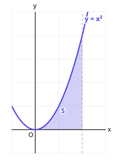

# 5. 부정적분과 정적분

> **먼저 알아야 할 것**: [3. 미분계수와 도함수](03-derivatives.md)
>
> **한 줄 요약**: 적분은 미분을 거꾸로 하는 것이고, 정적분은 그래프 아래의 넓이를 구하는 도구입니다.

## 1. 부정적분: 미분을 거꾸로

"미분해서 $2x$가 되는 함수는?" $x^2$이지요. 그런데 $x^2 + 1$, $x^2 - 5$도 미분하면 $2x$입니다. 상수는 미분하면 사라지니까요.

그래서 미분해서 $f(x)$가 되는 함수(**부정적분**)를 이렇게 씁니다.

$$
\int 2x\,dx = x^2 + C
$$

$C$는 **적분상수**로, "어떤 상수든 붙어 있을 수 있다"는 표시입니다.

> 💡 $\int$은 "인티그럴"이라고 읽고, $dx$는 "$x$에 대해 적분한다"는 표시입니다. 기호의 시작과 끝으로 보면 됩니다.

### 적분 공식

미분 공식 $(x^{n+1})' = (n + 1)x^n$을 거꾸로 하면

$$
\int x^n\,dx = \frac{1}{n + 1}x^{n+1} + C \quad (n \neq -1)
$$

> 💡 **지수를 1 올리고, 올린 지수로 나눈다.** 미분과 정확히 반대 순서예요.

| $f(x)$ | $\int f(x)\,dx$ |
|---|---|
| $k$ (상수) | $kx + C$ |
| $x$ | $\dfrac{1}{2}x^2 + C$ |
| $x^2$ | $\dfrac{1}{3}x^3 + C$ |
| $x^3$ | $\dfrac{1}{4}x^4 + C$ |

다항함수는 **항별로** 적분합니다.

$$
\int (3x^2 - 4x + 5)\,dx = x^3 - 2x^2 + 5x + C
$$

> 💡 **검산은 미분으로!** 결과를 미분해서 원래 함수가 나오면 맞습니다.

### 적분상수 정하기

조건이 주어지면 $C$를 구할 수 있습니다.

예) $f'(x) = 2x + 3$, $f(0) = 1$일 때 $f(x)$는?

$f(x) = x^2 + 3x + C$, $f(0) = C = 1$ → $f(x) = x^2 + 3x + 1$

## 2. 정적분: 범위가 정해진 적분

$f(x)$의 부정적분 중 하나를 $F(x)$라 할 때

$$
\int_a^b f(x)\,dx = \Big[F(x)\Big]_a^b = F(b) - F(a)
$$

이것을 **정적분**이라고 합니다. 결과가 함수가 아니라 **숫자**로 나옵니다. ($C$는 빼면서 사라지므로 안 써도 됩니다.)

**예)**

$$
\int_1^3 2x\,dx = \Big[x^2\Big]_1^3 = 9 - 1 = 8
$$

**예)**

$$
\int_0^2 (3x^2 + 1)\,dx = \Big[x^3 + x\Big]_0^2 = (8 + 2) - 0 = 10
$$

## 3. 정적분은 넓이다

$f(x) \ge 0$일 때 $\displaystyle\int_a^b f(x)\,dx$는 $y = f(x)$의 그래프, $x$축, 직선 $x = a$, $x = b$로 둘러싸인 부분의 **넓이**입니다.

위 그림의 색칠한 넓이 $S$는

$$
S = \int_0^2 x^2\,dx = \left[\frac{1}{3}x^3\right]_0^2 = \frac{8}{3}
$$

**왜 넓이일까요?** 넓이를 아주 얇은 직사각형(가로 $dx$, 세로 $f(x)$)으로 쪼개서 모두 더한다고 생각하세요. 직사각형을 무한히 얇게 하면 정확한 넓이가 되는데, 이 "무한히 더하기"를 계산해 주는 것이 바로 미분의 반대(부정적분)라는 것이 **미적분의 기본정리**입니다. $\int$ 기호 자체가 "합(Sum)"의 S를 길게 늘인 모양이에요.

## 4. 정적분의 성질

$$
\int_a^b \{f(x) \pm g(x)\}\,dx = \int_a^b f(x)\,dx \pm \int_a^b g(x)\,dx
$$

$$
\int_a^c f(x)\,dx = \int_a^b f(x)\,dx + \int_b^c f(x)\,dx
$$

$$
\int_a^a f(x)\,dx = 0, \qquad \int_b^a f(x)\,dx = -\int_a^b f(x)\,dx
$$

### 대칭성 활용

$-a$부터 $a$까지 적분할 때

- $x^2$, $x^4$, 상수처럼 **$y$축 대칭**인 항(짝수 차수): $\displaystyle\int_{-a}^a = 2\int_0^a$
- $x$, $x^3$처럼 **원점 대칭**인 항(홀수 차수): $\displaystyle\int_{-a}^a = 0$

예) $\displaystyle\int_{-1}^1 (x^3 + 3x^2 + x)\,dx = 2\int_0^1 3x^2\,dx = 2\Big[x^3\Big]_0^1 = 2$

## 예제

**예제 1.** $\displaystyle\int (4x^3 - 6x + 2)\,dx$

> 풀이: $x^4 - 3x^2 + 2x + C$

**예제 2.** $\displaystyle\int_{-1}^{2} (x^2 - 2x)\,dx$

> 풀이: $\left[\dfrac{1}{3}x^3 - x^2\right]_{-1}^{2} = \left(\dfrac{8}{3} - 4\right) - \left(-\dfrac{1}{3} - 1\right) = -\dfrac{4}{3} + \dfrac{4}{3} = 0$

**예제 3.** $f'(x) = 6x^2 - 2$이고 $f(1) = 3$일 때 $f(x)$는?

> 풀이: $f(x) = 2x^3 - 2x + C$, $f(1) = 0 + C = 3$ → $f(x) = 2x^3 - 2x + 3$

## 연습문제

1. $\displaystyle\int 5\,dx$, $\displaystyle\int x^4\,dx$
2. $\displaystyle\int (6x^2 + 4x - 1)\,dx$
3. $\displaystyle\int (x + 1)(x - 1)\,dx$
4. $f'(x) = 3x^2 + 1$, $f(0) = 2$일 때 $f(x)$
5. $\displaystyle\int_0^3 x^2\,dx$
6. $\displaystyle\int_1^2 (2x + 3)\,dx$
7. $\displaystyle\int_{-2}^{2} (x^3 + x^2)\,dx$
8. $\displaystyle\int_0^1 (x^2 + 1)\,dx + \int_1^3 (x^2 + 1)\,dx$

## 정답과 풀이

1. $5x + C$, $\dfrac{1}{5}x^5 + C$
2. $2x^3 + 2x^2 - x + C$
3. $\dfrac{1}{3}x^3 - x + C$ (먼저 전개: $x^2 - 1$)
4. $f(x) = x^3 + x + 2$
5. $9$ ($\dfrac{27}{3}$)
6. $6$ ($\Big[x^2 + 3x\Big]_1^2 = 10 - 4$)
7. $\dfrac{16}{3}$ ($2\displaystyle\int_0^2 x^2\,dx = 2 \times \dfrac{8}{3}$)
8. $12$ (구간을 합치면 $\displaystyle\int_0^3 (x^2 + 1)\,dx = \left[\dfrac{1}{3}x^3 + x\right]_0^3 = 9 + 3$)

---

이전 단원: [4. 도함수의 활용](04-derivative-applications.md) · 다음 단원: [6. 정적분의 활용](06-integral-applications.md)
