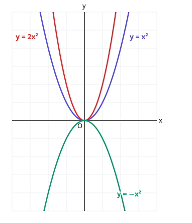
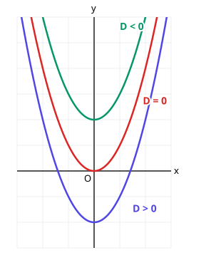

# 7. 이차방정식과 이차함수

> **먼저 알아야 할 것**: [0단계 4. 함수가 뭐예요?](../basics/04-functions.md), [6. 이차방정식](06-quadratic-equations.md)
>
> **한 줄 요약**: 이차함수의 그래프는 포물선이고, 이차방정식의 근은 포물선이 $x$축과 만나는 점입니다.

## 이차함수 $y = ax^2$

$y = x^2$에 값을 넣어 표를 만들어 봅시다.

| $x$ | $-2$ | $-1$ | $0$ | $1$ | $2$ |
|---|---|---|---|---|---|
| $y$ | $4$ | $1$ | $0$ | $1$ | $4$ |

점을 이으면 아래로 볼록한 U자 곡선이 됩니다. 이것을 **포물선**이라고 합니다. (공을 던졌을 때 날아가는 길과 모양이 같아서 붙은 이름이에요.)

- $a > 0$이면 **아래로 볼록** (U), $a < 0$이면 **위로 볼록** (∩)
- $|a|$가 클수록 폭이 **좁아집니다**
- 꺾이는 점(**꼭짓점**)은 원점 $(0, 0)$, 대칭축은 $y$축

## 이차함수 $y = a(x - p)^2 + q$: 옮기기

$y = a(x - p)^2 + q$의 그래프는 $y = ax^2$을

- $x$축 방향으로 $p$만큼
- $y$축 방향으로 $q$만큼

**평행이동**한 것입니다. 모양은 그대로, 위치만 바뀝니다.

- 꼭짓점: $(p, q)$
- 대칭축: $x = p$

> 💡 $y = (x - 2)^2$은 **오른쪽**으로 2만큼 이동한 것입니다. 괄호 안이 "마이너스"인데 오른쪽이라서 헷갈리지요. $x = 2$일 때 괄호가 0이 되어 꼭짓점이 된다고 생각하면 쉽습니다.

## $y = ax^2 + bx + c$를 꼭짓점 꼴로 바꾸기

[근의 공식을 만들 때](06-quadratic-equations.md) 했던 **완전제곱식 만들기**를 씁니다.

$$
\begin{aligned}
y &= x^2 - 2x - 3 \\
&= (x^2 - 2x + 1) - 1 - 3 \\
&= (x - 1)^2 - 4
\end{aligned}
$$

꼭짓점은 $(1, -4)$, 대칭축은 $x = 1$입니다.

> 💡 **빠른 공식**: $y = ax^2 + bx + c$의 꼭짓점의 $x$좌표는 $x = -\dfrac{b}{2a}$. 여기에 넣어서 $y$좌표를 구하면 됩니다. 예) $-\dfrac{-2}{2} = 1$, $y = 1 - 2 - 3 = -4$

### 그래프 그리는 순서

1. 볼록한 방향: $a$의 부호
2. 꼭짓점: 완전제곱식으로
3. $y$절편: $x = 0$ 넣기 → $(0, c)$
4. $x$절편: $y = 0$인 방정식 풀기

## 이차방정식과 이차함수의 관계

위 그래프에서 포물선이 $x$축과 만나는 점은 $x = -1$, $x = 3$입니다. 그런데 이것은

$$
x^2 - 2x - 3 = 0 \;\Rightarrow\; (x + 1)(x - 3) = 0
$$

의 근과 똑같습니다! $x$축은 $y = 0$인 곳이니까요.

> 💡 **이차방정식 $ax^2 + bx + c = 0$의 실근 = 포물선 $y = ax^2 + bx + c$가 $x$축과 만나는 점의 $x$좌표**

그래서 [판별식](06-quadratic-equations.md) $D$로 그래프와 $x$축의 위치 관계를 알 수 있습니다.

| $D$ | 근 | 그래프와 $x$축 |
|---|---|---|
| $D > 0$ | 서로 다른 두 실근 | 두 점에서 만남 |
| $D = 0$ | 중근 | 한 점에서 **접함** |
| $D < 0$ | 허근 | 만나지 않음 |

## 포물선과 직선

포물선 $y = x^2 + 1$과 직선 $y = 2x + k$가 만나는지 알고 싶으면, 두 식을 같다고 놓습니다.

$$
x^2 + 1 = 2x + k \;\Rightarrow\; x^2 - 2x + 1 - k = 0
$$

이 방정식의 판별식으로 판단합니다. 위치 관계는 위 표와 똑같아요. 예를 들어 접하려면 $D = 4 - 4(1 - k) = 0$, 즉 $k = 0$입니다.

## 최댓값과 최솟값

아래로 볼록한 포물선은 꼭짓점에서 **가장 낮고**, 위로 볼록하면 꼭짓점에서 **가장 높습니다**.

- $y = (x - 1)^2 - 4$: 최솟값 $-4$ ($x = 1$일 때), 최댓값 없음
- $y = -(x + 2)^2 + 5$: 최댓값 $5$ ($x = -2$일 때), 최솟값 없음

### 범위가 정해져 있으면

$-1 \le x \le 2$처럼 범위가 있으면 **꼭짓점과 양 끝값**을 모두 비교합니다.

예) $y = (x - 1)^2 - 4$, $2 \le x \le 4$일 때: 꼭짓점 $x = 1$이 범위 밖이므로 양 끝만 계산합니다. $x = 2$일 때 $-3$, $x = 4$일 때 $5$ → 최솟값 $-3$, 최댓값 $5$

## 예제

**예제 1.** $y = 2x^2 + 8x + 5$의 꼭짓점은?

> 풀이: $y = 2(x^2 + 4x + 4) - 8 + 5 = 2(x + 2)^2 - 3$. 꼭짓점 $(-2, -3)$

**예제 2.** $y = x^2 - 4x + k$의 그래프가 $x$축과 접할 때 $k$는?

> 풀이: $D = 16 - 4k = 0$, $k = 4$

**예제 3.** 길이 20m인 끈으로 직사각형을 만들 때 넓이의 최댓값은?

> 풀이: 가로를 $x$라 하면 세로는 $10 - x$
>
> 넓이 $= x(10 - x) = -x^2 + 10x = -(x - 5)^2 + 25$
>
> $x = 5$일 때 최댓값 $25\text{m}^2$ (정사각형일 때!)

## 연습문제

1. $y = (x + 3)^2 - 1$의 꼭짓점과 대칭축은?
2. $y = x^2 + 6x + 7$을 $y = a(x - p)^2 + q$ 꼴로 바꾸세요.
3. $y = -x^2 + 4x$의 최댓값은?
4. $y = x^2 - 3x + 5$의 그래프와 $x$축의 위치 관계는?
5. 포물선 $y = x^2$과 직선 $y = x + k$가 서로 다른 두 점에서 만날 $k$의 범위는?
6. $0 \le x \le 3$에서 $y = x^2 - 2x + 3$의 최댓값과 최솟값은?

## 정답과 풀이

1. 꼭짓점 $(-3, -1)$, 대칭축 $x = -3$
2. $y = (x + 3)^2 - 2$
3. $4$ ($y = -(x - 2)^2 + 4$)
4. 만나지 않음 ($D = 9 - 20 < 0$)
5. $k > -\dfrac{1}{4}$ ($x^2 - x - k = 0$에서 $D = 1 + 4k > 0$)
6. 최댓값 $6$ ($x = 3$), 최솟값 $2$ ($x = 1$, $y = (x - 1)^2 + 2$)

---

이전 단원: [6. 이차방정식](06-quadratic-equations.md) · 다음 단원: [8. 여러 가지 방정식과 부등식](08-equations-inequalities.md)
