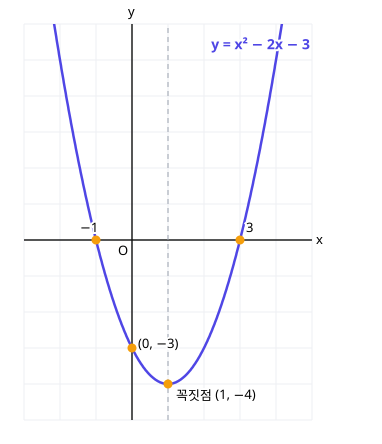

# 8. 여러 가지 방정식과 부등식

> **먼저 알아야 할 것**: [4. 인수분해](04-factoring.md), [7. 이차방정식과 이차함수](07-quadratic-functions.md)
>
> **한 줄 요약**: 고차방정식은 인수분해로 쪼개고, 부등식은 그래프를 보면 답이 보입니다.

## 1. 삼차방정식과 사차방정식

$x^3$, $x^4$이 들어간 방정식도 원리는 같습니다. **인수분해해서 곱이 0인 꼴**로 만들면 됩니다.

**예)** $x^3 - 6x^2 + 11x - 6 = 0$

[인수정리](03-remainder-theorem.md)로 $x = 1$을 넣으면 0이 되므로, 조립제법으로 나누면

$$
(x - 1)(x - 2)(x - 3) = 0 \;\Rightarrow\; x = 1, 2, 3
$$

**예)** $x^4 - 5x^2 + 4 = 0$

$x^2 = t$로 치환하면 $t^2 - 5t + 4 = (t - 1)(t - 4) = 0$

$x^2 = 1$ 또는 $x^2 = 4$ → $x = \pm 1, \pm 2$

> 💡 $n$차방정식은 복소수 범위에서 근이 (중근 포함) 정확히 $n$개 있습니다.

## 2. 연립이차방정식

일차식과 이차식이 섞인 연립방정식은 **일차식을 한 문자에 대해 풀어서 대입**합니다.

$$
\begin{cases}
x - y = 1 \\
x^2 + y^2 = 13
\end{cases}
$$

첫 식에서 $x = y + 1$을 둘째 식에 넣으면

$$
(y + 1)^2 + y^2 = 13 \;\Rightarrow\; 2y^2 + 2y - 12 = 0 \;\Rightarrow\; y^2 + y - 6 = 0
$$

$(y + 3)(y - 2) = 0$ 이므로 $y = -3$ 또는 $y = 2$

- $y = -3$이면 $x = -2$
- $y = 2$이면 $x = 3$

답: $(x, y) = (-2, -3)$ 또는 $(3, 2)$

## 3. 일차부등식

부등식은 방정식과 거의 똑같이 풀지만, **딱 하나** 다릅니다.

> 💡 **양변에 음수를 곱하거나 나누면 부등호 방향이 바뀝니다.**
>
> 예) $3 > 1$인데 양변에 $-1$을 곱하면 $-3 < -1$

**예)** $-2x + 3 > 7$

$-2x > 4$ → 양변을 $-2$로 나누면 $x < -2$ (방향 바뀜!)

### 연립일차부등식

두 부등식을 **동시에** 만족하는 범위, 즉 수직선에서 겹치는 부분을 찾습니다.

$$
\begin{cases} x + 1 > 3 \\ 2x - 1 \le 9 \end{cases}
\;\Rightarrow\;
\begin{cases} x > 2 \\ x \le 5 \end{cases}
\;\Rightarrow\; 2 < x \le 5
$$

### 절댓값이 있는 부등식

$|x|$는 수직선에서 $0$과 $x$ 사이의 거리입니다. 그래서

- $|x| < a$ → 거리가 $a$보다 가까움 → $-a < x < a$
- $|x| > a$ → 거리가 $a$보다 멂 → $x < -a$ 또는 $x > a$

**예)** $|x - 1| < 3$ → $-3 < x - 1 < 3$ → $-2 < x < 4$

## 4. 이차부등식: 그래프로 풀기

$x^2 - 2x - 3 > 0$을 풀어 봅시다.

[이전 단원](07-quadratic-functions.md)에서 그린 $y = x^2 - 2x - 3$의 그래프를 떠올리세요. $x$축과 $x = -1$, $x = 3$에서 만납니다.

- $y > 0$ (그래프가 $x$축 **위**): $x < -1$ 또는 $x > 3$
- $y < 0$ (그래프가 $x$축 **아래**): $-1 < x < 3$

그래서

| 부등식 | 해 |
|---|---|
| $x^2 - 2x - 3 > 0$ | $x < -1$ 또는 $x > 3$ |
| $x^2 - 2x - 3 \ge 0$ | $x \le -1$ 또는 $x \ge 3$ |
| $x^2 - 2x - 3 < 0$ | $-1 < x < 3$ |
| $x^2 - 2x - 3 \le 0$ | $-1 \le x \le 3$ |

> 💡 **외우는 법** ($x^2$ 계수가 양수, 두 근 $\alpha < \beta$일 때): "**크면 바깥, 작으면 사이**"
>
> - $(x - \alpha)(x - \beta) > 0$ → $x < \alpha$ 또는 $x > \beta$
> - $(x - \alpha)(x - \beta) < 0$ → $\alpha < x < \beta$

### $x^2$의 계수가 음수이면

양변에 $-1$을 곱해서 양수로 바꾸고 부등호를 뒤집은 다음 푸세요.

$-x^2 + x + 6 \ge 0$ → $x^2 - x - 6 \le 0$ → $(x + 2)(x - 3) \le 0$ → $-2 \le x \le 3$

### 판별식이 0 이하일 때

- $x^2 - 2x + 1 > 0$ → $(x - 1)^2 > 0$ → $x \neq 1$인 모든 실수
- $x^2 + x + 1 > 0$ → $D < 0$이라 그래프가 항상 $x$축 위 → **모든 실수**
- $x^2 + x + 1 < 0$ → **해가 없다**

## 예제

**예제 1.** $x^3 - 8 = 0$의 근을 모두 구하세요.

> 풀이: $(x - 2)(x^2 + 2x + 4) = 0$
>
> $x = 2$ 또는 $x = -1 \pm \sqrt{3}\,i$

**예제 2.** $x^2 - 5x + 4 \le 0$

> 풀이: $(x - 1)(x - 4) \le 0$ → 작으면 사이 → $1 \le x \le 4$

**예제 3.** 모든 실수 $x$에 대하여 $x^2 + kx + 4 > 0$이 성립할 $k$의 범위는?

> 풀이: 그래프가 항상 $x$축 위에 있어야 하므로 $D < 0$
>
> $k^2 - 16 < 0$ → $-4 < k < 4$

## 연습문제

1. $x^3 - x = 0$
2. $x^4 - 16 = 0$ (복소수 범위)
3. $\begin{cases} y = x + 1 \\ x^2 + y = 7 \end{cases}$
4. $3 - 2x \ge 7$
5. $|2x - 1| \le 5$
6. $x^2 - x - 12 > 0$
7. $x^2 + 4x + 4 \le 0$
8. $-x^2 + 4x - 3 > 0$

## 정답과 풀이

1. $x = -1, 0, 1$ ($x(x + 1)(x - 1) = 0$)
2. $x = \pm 2, \pm 2i$ ($(x^2 - 4)(x^2 + 4) = 0$)
3. $(x, y) = (2, 3)$ 또는 $(-3, -2)$ ($x^2 + x - 6 = 0$)
4. $x \le -2$ ($-2x \ge 4$, 음수로 나누니 방향 바뀜)
5. $-2 \le x \le 3$ ($-5 \le 2x - 1 \le 5$)
6. $x < -3$ 또는 $x > 4$ ($(x + 3)(x - 4) > 0$)
7. $x = -2$ ($(x + 2)^2 \le 0$은 $0$일 때만)
8. $1 < x < 3$ ($x^2 - 4x + 3 < 0$, $(x - 1)(x - 3) < 0$)

---

이전 단원: [7. 이차방정식과 이차함수](07-quadratic-functions.md) · 다음 단원: [9. 경우의 수](09-counting.md)
