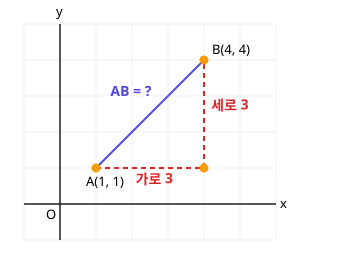

# 1. 평면좌표

> **먼저 알아야 할 것**: [0단계 6. 제곱근과 무리수](../basics/06-square-roots.md)
>
> **한 줄 요약**: 두 점 사이의 거리는 피타고라스 정리, 중간 지점은 평균입니다.

공통수학2의 앞부분은 **도형을 식으로 다루는 법**(도형의 방정식)을 배웁니다. 그림으로 보면 쉬운 것들이 많으니 꼭 손으로 좌표평면을 그리면서 읽으세요.

## 좌표평면 복습

가로축이 $x$축, 세로축이 $y$축입니다. 점 $(3, 2)$는 원점에서 **오른쪽으로 3, 위로 2** 간 곳입니다. 앞의 수가 $x$, 뒤의 수가 $y$예요.

## 수직선 위의 두 점 사이의 거리

수직선 위의 두 점 $A(a)$, $B(b)$ 사이의 거리는 큰 수에서 작은 수를 뺀 것, 즉

$$
\overline{AB} = |b - a|
$$

예) $A(-2)$, $B(5)$ → $|5 - (-2)| = 7$

## 좌표평면 위의 두 점 사이의 거리

$A(1, 1)$과 $B(4, 4)$ 사이의 거리를 구해 봅시다.

$A$에서 $B$로 가려면 가로로 3, 세로로 3을 가야 합니다. 그러면 직각삼각형이 생기지요. **피타고라스 정리** (직각삼각형에서 (빗변)² = (밑변)² + (높이)²)를 쓰면

$$
\overline{AB}^2 = 3^2 + 3^2 = 18 \;\Rightarrow\; \overline{AB} = \sqrt{18} = 3\sqrt{2}
$$

일반적으로 $A(x_1, y_1)$, $B(x_2, y_2)$ 사이의 거리는

$$
\overline{AB} = \sqrt{(x_2 - x_1)^2 + (y_2 - y_1)^2}
$$

> 💡 "**가로 차이의 제곱 + 세로 차이의 제곱, 그리고 루트**." 제곱하니까 어느 쪽에서 빼든 상관없습니다.

특히 원점 $O$와 점 $(x, y)$ 사이의 거리는 $\sqrt{x^2 + y^2}$입니다.

## 선분의 중점: 평균

두 점의 **한가운데** 점은 좌표의 평균입니다.

$$
\text{중점} = \left( \frac{x_1 + x_2}{2},\; \frac{y_1 + y_2}{2} \right)
$$

예) $A(1, 2)$, $B(5, 8)$의 중점은 $\left(\dfrac{1 + 5}{2}, \dfrac{2 + 8}{2}\right) = (3, 5)$

## 내분점: 선분을 $m : n$으로 나누는 점

선분 $AB$ 위에서 $A$ 쪽부터 $m : n$으로 나누는 점 $P$를 **내분점**이라고 합니다.

$$
P = \left( \frac{m x_2 + n x_1}{m + n},\; \frac{m y_2 + n y_1}{m + n} \right)
$$

> 💡 **엇갈려 곱한다**고 기억하세요. $m$은 $B$의 좌표($x_2$)에, $n$은 $A$의 좌표($x_1$)에 곱합니다. 중점은 $m = n = 1$인 경우예요.

예) $A(1, 1)$, $B(7, 4)$를 $2 : 1$로 내분하는 점

$$
\left( \frac{2 \cdot 7 + 1 \cdot 1}{3},\; \frac{2 \cdot 4 + 1 \cdot 1}{3} \right) = (5, 3)
$$

확인: $A$에서 $B$까지 가로 6 중 $\frac{2}{3}$인 4만큼 간 곳이 $x = 5$ ✔

## 삼각형의 무게중심

세 꼭짓점 $A(x_1, y_1)$, $B(x_2, y_2)$, $C(x_3, y_3)$인 삼각형의 무게중심은 세 좌표의 평균입니다.

$$
G = \left( \frac{x_1 + x_2 + x_3}{3},\; \frac{y_1 + y_2 + y_3}{3} \right)
$$

## 예제

**예제 1.** $A(-1, 2)$, $B(3, -1)$ 사이의 거리는?

> 풀이: $\sqrt{(3 - (-1))^2 + (-1 - 2)^2} = \sqrt{16 + 9} = 5$

**예제 2.** 두 점 $A(1, a)$, $B(4, 5)$ 사이의 거리가 $5$일 때 $a$는?

> 풀이: $(4 - 1)^2 + (5 - a)^2 = 25$ → $(5 - a)^2 = 16$ → $5 - a = \pm 4$
>
> $a = 1$ 또는 $a = 9$

**예제 3.** $A(0, 0)$, $B(6, 0)$, $C(3, 6)$인 삼각형의 무게중심은?

> 풀이: $\left(\dfrac{0 + 6 + 3}{3}, \dfrac{0 + 0 + 6}{3}\right) = (3, 2)$

## 연습문제

1. 수직선 위의 두 점 $A(-3)$, $B(4)$ 사이의 거리
2. $A(2, 3)$, $B(5, 7)$ 사이의 거리
3. 원점과 $P(-5, 12)$ 사이의 거리
4. $A(-2, 4)$, $B(6, 0)$의 중점
5. $A(0, 0)$, $B(9, 6)$을 $1 : 2$로 내분하는 점
6. $A(1, 2)$, $B(3, 0)$, $C(5, 7)$인 삼각형의 무게중심
7. 두 점 $A(1, 2)$, $B(3, 4)$에서 같은 거리에 있는 $x$축 위의 점

## 정답과 풀이

1. $7$
2. $5$ ($\sqrt{9 + 16}$)
3. $13$ ($\sqrt{25 + 144}$)
4. $(2, 2)$
5. $(3, 2)$ ($\left(\dfrac{1 \cdot 9 + 2 \cdot 0}{3}, \dfrac{1 \cdot 6 + 2 \cdot 0}{3}\right)$)
6. $(3, 3)$
7. $(5, 0)$ (점을 $(x, 0)$이라 하면 $(x - 1)^2 + 4 = (x - 3)^2 + 16$ → $-2x + 5 = -6x + 25$ → $x = 5$)

---

이전 단원: [공통수학1 - 10. 행렬](../common1/10-matrices.md) · 다음 단원: [2. 직선의 방정식](02-lines.md)
