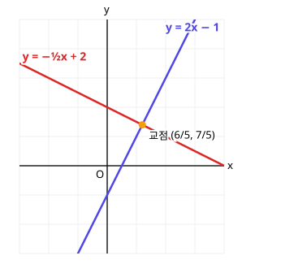

# 2. 직선의 방정식

> **먼저 알아야 할 것**: [0단계 4. 함수가 뭐예요?](../basics/04-functions.md), [1. 평면좌표](01-coordinates.md)
>
> **한 줄 요약**: 직선은 "기울기"와 "지나는 점 하나"만 알면 식이 정해집니다.

## 기울기 복습

[0단계 4단원](../basics/04-functions.md)에서 $y = ax + b$의 $a$가 기울기라고 했습니다. 두 점 $(x_1, y_1)$, $(x_2, y_2)$를 지나는 직선의 기울기는

$$
\text{기울기} = \frac{y\text{의 증가량}}{x\text{의 증가량}} = \frac{y_2 - y_1}{x_2 - x_1}
$$

예) $(1, 2)$와 $(3, 8)$을 지나면 기울기는 $\dfrac{8 - 2}{3 - 1} = 3$

> 💡 기울기 = "오른쪽으로 1 갈 때 위로 얼마나 올라가나". 계단의 가파른 정도라고 생각하세요.

## 직선의 방정식 만들기

### 1. 기울기 $m$, 한 점 $(x_1, y_1)$을 알 때

$$
y - y_1 = m(x - x_1)
$$

예) 기울기 2, 점 $(1, 3)$을 지나는 직선: $y - 3 = 2(x - 1)$ → $y = 2x + 1$

### 2. 두 점을 알 때

먼저 기울기를 구한 다음 1번 방법을 씁니다.

예) $(1, 2)$, $(3, 8)$: 기울기 3 → $y - 2 = 3(x - 1)$ → $y = 3x - 1$

### 3. 특별한 직선

- $x$축에 평행한 직선 (가로선): $y = k$ (기울기 0)
- $y$축에 평행한 직선 (세로선): $x = k$ (기울기 없음)

### 일반형

$y = 2x + 1$을 $2x - y + 1 = 0$처럼 $ax + by + c = 0$ 꼴로 쓴 것을 **일반형**이라고 합니다. 세로선 $x = k$까지 모두 나타낼 수 있어서 편리합니다.

## 두 직선의 위치 관계

두 직선 $y = m_1 x + n_1$, $y = m_2 x + n_2$에 대해

| 관계 | 조건 |
|---|---|
| 평행 | 기울기 같고 $y$절편 다름: $m_1 = m_2$, $n_1 \neq n_2$ |
| 일치 | 기울기, $y$절편 모두 같음 |
| 한 점에서 만남 | 기울기 다름: $m_1 \neq m_2$ |
| **수직** | **기울기의 곱이 $-1$**: $m_1 m_2 = -1$ |

위 그림에서 $y = 2x - 1$과 $y = -\dfrac{1}{2}x + 2$는 기울기의 곱이 $2 \times \left(-\dfrac{1}{2}\right) = -1$이므로 **수직**입니다.

> 💡 수직인 직선의 기울기 = **뒤집고 부호 바꾸기**. 기울기 $3$에 수직이면 $-\dfrac{1}{3}$

### 교점 구하기

두 직선이 만나는 점은 [연립방정식](../basics/05-systems.md)의 해입니다.

$2x - 1 = -\dfrac{1}{2}x + 2$ → $\dfrac{5}{2}x = 3$ → $x = \dfrac{6}{5}$, $y = \dfrac{7}{5}$

## 점과 직선 사이의 거리

점 $(x_1, y_1)$에서 직선 $ax + by + c = 0$까지의 (가장 짧은) 거리는

$$
d = \frac{|a x_1 + b y_1 + c|}{\sqrt{a^2 + b^2}}
$$

> 💡 **분자**: 점의 좌표를 직선의 식에 넣고 절댓값. **분모**: $x$, $y$ 계수 제곱의 합에 루트.

예) 원점에서 직선 $3x + 4y - 10 = 0$까지의 거리: $\dfrac{|0 + 0 - 10|}{\sqrt{9 + 16}} = \dfrac{10}{5} = 2$

## 예제

**예제 1.** 점 $(2, -1)$을 지나고 직선 $y = 3x + 5$에 평행한 직선은?

> 풀이: 평행하니 기울기 3. $y + 1 = 3(x - 2)$ → $y = 3x - 7$

**예제 2.** 점 $(1, 4)$를 지나고 직선 $y = 2x - 3$에 수직인 직선은?

> 풀이: 수직이니 기울기 $-\dfrac{1}{2}$. $y - 4 = -\dfrac{1}{2}(x - 1)$ → $y = -\dfrac{1}{2}x + \dfrac{9}{2}$

**예제 3.** 점 $(1, 2)$와 직선 $x - y + 3 = 0$ 사이의 거리는?

> 풀이: $\dfrac{|1 - 2 + 3|}{\sqrt{1 + 1}} = \dfrac{2}{\sqrt{2}} = \sqrt{2}$

## 연습문제

1. 두 점 $(-1, 5)$, $(2, -1)$을 지나는 직선의 기울기와 방정식
2. 기울기가 $-3$이고 점 $(2, 1)$을 지나는 직선
3. 점 $(3, 5)$를 지나고 $x$축에 평행한 직선, $y$축에 평행한 직선
4. 직선 $y = ax + 1$과 $y = 4x - 2$가 평행할 때 $a$, 수직일 때 $a$
5. 두 직선 $y = x + 1$과 $y = -2x + 7$의 교점
6. 점 $(2, 3)$과 직선 $4x + 3y + 3 = 0$ 사이의 거리

## 정답과 풀이

1. 기울기 $-2$, $y = -2x + 3$
2. $y = -3x + 7$
3. $y = 5$, $x = 3$
4. 평행: $a = 4$, 수직: $a = -\dfrac{1}{4}$
5. $(2, 3)$ ($x + 1 = -2x + 7$)
6. $4$ ($\dfrac{|8 + 9 + 3|}{\sqrt{16 + 9}} = \dfrac{20}{5}$)

---

이전 단원: [1. 평면좌표](01-coordinates.md) · 다음 단원: [3. 원의 방정식](03-circles.md)
