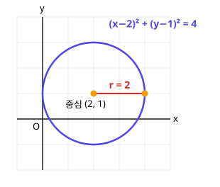

# 3. 원의 방정식

> **먼저 알아야 할 것**: [1. 평면좌표](01-coordinates.md), [2. 직선의 방정식](02-lines.md)
>
> **한 줄 요약**: 원은 "중심에서 거리가 반지름인 점들"이므로, 거리 공식이 곧 원의 방정식입니다.

## 원의 방정식 만들기

원은 **한 점(중심)에서 같은 거리(반지름)에 있는 점들의 모임**입니다.

중심이 $(a, b)$, 반지름이 $r$인 원 위의 점 $(x, y)$는 중심까지의 거리가 $r$이므로, [두 점 사이의 거리](01-coordinates.md) 공식에서

$$
\sqrt{(x - a)^2 + (y - b)^2} = r
$$

양변을 제곱하면

$$
\boxed{(x - a)^2 + (y - b)^2 = r^2}
$$

예) 중심 $(2, 1)$, 반지름 $2$인 원: $(x - 2)^2 + (y - 1)^2 = 4$

특히 중심이 원점이면 $x^2 + y^2 = r^2$

> 💡 이차함수의 꼭짓점처럼, 괄호 안의 부호와 **반대**가 중심 좌표입니다. $(x + 3)^2 + (y - 1)^2 = 5$의 중심은 $(-3, 1)$, 반지름은 $\sqrt{5}$

## 전개된 식에서 중심과 반지름 찾기

$x^2 + y^2 - 4x + 6y - 3 = 0$처럼 전개되어 있으면 **완전제곱식**으로 되돌립니다.

$$
\begin{aligned}
(x^2 - 4x) + (y^2 + 6y) &= 3 \\
(x^2 - 4x + 4) + (y^2 + 6y + 9) &= 3 + 4 + 9 \\
(x - 2)^2 + (y + 3)^2 &= 16
\end{aligned}
$$

중심 $(2, -3)$, 반지름 $4$

## 원과 직선의 위치 관계

원의 중심에서 직선까지의 거리 $d$와 반지름 $r$을 비교합니다. ([점과 직선 사이의 거리](02-lines.md) 공식 사용)

| 관계 | 조건 | 만나는 점 |
|---|---|---|
| 두 점에서 만남 | $d < r$ | 2개 |
| 접함 | $d = r$ | 1개 |
| 만나지 않음 | $d > r$ | 0개 |

> 💡 원과 직선의 식을 연립해서 이차방정식의 [판별식](../common1/06-quadratic-equations.md)으로 판단해도 같은 결과가 나옵니다. 보통은 거리 비교가 더 빠릅니다.

**예)** 원 $x^2 + y^2 = 4$와 직선 $x + y - 2 = 0$

중심 $(0, 0)$에서 직선까지 거리 $d = \dfrac{|-2|}{\sqrt{2}} = \sqrt{2} \approx 1.41$

$r = 2$이므로 $d < r$ → 두 점에서 만남

## 원의 접선

원 $x^2 + y^2 = r^2$ 위의 점 $(x_1, y_1)$에서의 접선은

$$
x_1 x + y_1 y = r^2
$$

> 💡 원의 식 $x \cdot x + y \cdot y = r^2$에서 $x$ 하나, $y$ 하나를 접점 좌표로 바꾼 모양입니다.

예) 원 $x^2 + y^2 = 25$ 위의 점 $(3, 4)$에서의 접선: $3x + 4y = 25$

접선은 접점과 중심을 잇는 반지름에 **수직**이라는 사실도 기억하세요.

## 예제

**예제 1.** 중심이 $(-1, 3)$이고 점 $(2, 7)$을 지나는 원의 방정식은?

> 풀이: 반지름 = 중심과 $(2, 7)$ 사이 거리 = $\sqrt{9 + 16} = 5$
>
> $(x + 1)^2 + (y - 3)^2 = 25$

**예제 2.** 두 점 $A(1, 2)$, $B(5, 6)$을 지름의 양 끝으로 하는 원은?

> 풀이: 중심은 중점 $(3, 4)$, 반지름은 $\dfrac{\overline{AB}}{2} = \dfrac{\sqrt{32}}{2} = 2\sqrt{2}$
>
> $(x - 3)^2 + (y - 4)^2 = 8$

**예제 3.** 원 $x^2 + y^2 = 5$와 직선 $2x + y + k = 0$이 접할 때 $k$는?

> 풀이: $d = \dfrac{|k|}{\sqrt{5}} = \sqrt{5}$ → $|k| = 5$ → $k = \pm 5$

## 연습문제

1. 중심 $(3, -2)$, 반지름 $4$인 원의 방정식
2. $(x + 5)^2 + y^2 = 7$의 중심과 반지름
3. $x^2 + y^2 + 2x - 8y + 8 = 0$의 중심과 반지름
4. 원점을 중심으로 하고 점 $(1, \sqrt{3})$을 지나는 원
5. 원 $x^2 + y^2 = 9$와 직선 $y = x + 6$의 위치 관계
6. 원 $x^2 + y^2 = 10$ 위의 점 $(1, 3)$에서의 접선

## 정답과 풀이

1. $(x - 3)^2 + (y + 2)^2 = 16$
2. 중심 $(-5, 0)$, 반지름 $\sqrt{7}$
3. 중심 $(-1, 4)$, 반지름 $3$ ($(x + 1)^2 + (y - 4)^2 = -8 + 1 + 16 = 9$)
4. $x^2 + y^2 = 4$
5. 만나지 않음 ($x - y + 6 = 0$까지 거리 $\dfrac{6}{\sqrt{2}} = 3\sqrt{2} > 3$)
6. $x + 3y = 10$

---

이전 단원: [2. 직선의 방정식](02-lines.md) · 다음 단원: [4. 도형의 이동](04-transformations.md)
