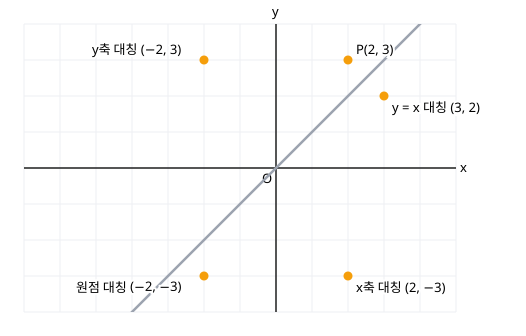

# 4. 도형의 이동

> **먼저 알아야 할 것**: [3. 원의 방정식](03-circles.md)
>
> **한 줄 요약**: 점은 좌표에 더하고, 도형의 식은 $x$, $y$ 자리에 **빼서** 넣습니다.

## 점의 평행이동

점 $(x, y)$를 $x$축 방향으로 $m$, $y$축 방향으로 $n$만큼 옮기면

$$
(x, y) \;\to\; (x + m,\; y + n)
$$

예) 점 $(2, 3)$을 $x$축 방향으로 $1$, $y$축 방향으로 $-4$만큼 이동 → $(3, -1)$

## 도형의 평행이동

도형의 방정식 $f(x, y) = 0$을 $x$축 방향으로 $m$, $y$축 방향으로 $n$만큼 옮기면

$$
f(x - m,\; y - n) = 0
$$

> 💡 **점은 더하고, 식은 뺀다.** 이차함수에서 $y = x^2$을 오른쪽으로 2만큼 옮기면 $y = (x - 2)^2$이었던 것과 같은 원리예요.

**왜 빼나요?** 옮긴 도형 위의 점 $(X, Y)$는 원래 도형의 점 $(X - m, Y - n)$을 옮긴 것입니다. 원래 점이 $f = 0$을 만족하니 $f(X - m, Y - n) = 0$이 되는 거예요.

**예)** 원 $x^2 + y^2 = 4$를 $x$축 방향으로 $3$, $y$축 방향으로 $-1$만큼 이동

$$
(x - 3)^2 + (y + 1)^2 = 4
$$

중심이 $(0, 0)$에서 $(3, -1)$로 옮겨진 것을 확인할 수 있습니다.

**예)** 직선 $y = 2x + 1$을 $x$축 방향으로 $1$만큼 이동: $y = 2(x - 1) + 1 = 2x - 1$

## 대칭이동

| 대칭 | 점 $(x, y)$의 이동 | 도형 $f(x, y) = 0$의 이동 |
|---|---|---|
| $x$축 대칭 | $(x, -y)$ | $f(x, -y) = 0$ |
| $y$축 대칭 | $(-x, y)$ | $f(-x, y) = 0$ |
| 원점 대칭 | $(-x, -y)$ | $f(-x, -y) = 0$ |
| 직선 $y = x$ 대칭 | $(y, x)$ | $f(y, x) = 0$ |

> 💡 **외우는 법**
>
> - $x$축 대칭: $x$축을 거울로 → 위아래가 뒤집힘 → $y$ 부호만 바뀜
> - $y$축 대칭: 좌우가 뒤집힘 → $x$ 부호만 바뀜
> - 원점 대칭: 둘 다 바뀜
> - $y = x$ 대칭: $x$와 $y$를 **맞바꿈**

**예)** 직선 $y = 2x + 3$을

- $x$축 대칭: $-y = 2x + 3$ → $y = -2x - 3$
- $y$축 대칭: $y = -2x + 3$
- $y = x$ 대칭: $x = 2y + 3$ → $y = \dfrac{1}{2}x - \dfrac{3}{2}$

## 예제

**예제 1.** 점 $(-1, 4)$를 원점에 대하여 대칭이동한 점은?

> 풀이: $(1, -4)$

**예제 2.** 원 $(x - 1)^2 + (y + 2)^2 = 9$를 $y$축에 대하여 대칭이동한 원의 중심은?

> 풀이: $x$ 대신 $-x$: $(-x - 1)^2 + (y + 2)^2 = 9$ → $(x + 1)^2 + (y + 2)^2 = 9$
>
> 중심 $(-1, -2)$. 중심 $(1, -2)$를 $y$축 대칭한 점과 같습니다.

**예제 3.** 포물선 $y = x^2$을 $x$축 방향으로 $-2$, $y$축 방향으로 $3$만큼 평행이동한 식은?

> 풀이: $y - 3 = (x + 2)^2$ → $y = (x + 2)^2 + 3$

## 연습문제

1. 점 $(4, -2)$를 $x$축 방향으로 $-3$, $y$축 방향으로 $5$만큼 평행이동한 점
2. 점 $(3, 5)$를 $x$축, $y$축, 원점, 직선 $y = x$에 대하여 각각 대칭이동한 점
3. 직선 $y = -x + 4$를 $x$축 방향으로 $2$만큼 평행이동한 직선
4. 원 $x^2 + y^2 - 4x = 0$을 $x$축에 대하여 대칭이동한 원
5. 직선 $3x - y + 1 = 0$을 직선 $y = x$에 대하여 대칭이동한 직선
6. 점 $(1, 2)$를 평행이동 $(x, y) \to (x + a, y - 3)$으로 옮겼더니 $(4, b)$가 되었습니다. $a$, $b$는?

## 정답과 풀이

1. $(1, 3)$
2. $(3, -5)$, $(-3, 5)$, $(-3, -5)$, $(5, 3)$
3. $y = -x + 6$ ($y = -(x - 2) + 4$)
4. $x^2 + y^2 - 4x = 0$ (그대로! 중심 $(2, 0)$이 $x$축 위에 있으니까요)
5. $3y - x + 1 = 0$, 즉 $y = \dfrac{1}{3}x - \dfrac{1}{3}$
6. $a = 3$, $b = -1$

---

이전 단원: [3. 원의 방정식](03-circles.md) · 다음 단원: [5. 집합](05-sets.md)
