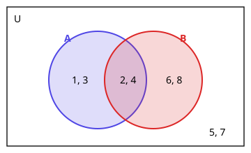

# 5. 집합

> **먼저 알아야 할 것**: 특별히 없음
>
> **한 줄 요약**: 집합은 "분명하게 정해지는 것들의 모임"이고, 합집합·교집합은 벤 다이어그램으로 보면 쉽습니다.

## 집합이란?

**누가 판단해도 속하는지 아닌지 분명한** 대상들의 모임을 집합이라고 합니다.

- "10보다 작은 자연수의 모임" → 집합 ✔ (1부터 9까지, 분명함)
- "키가 큰 학생의 모임" → 집합 아님 ✘ (얼마나 커야 큰 건지 사람마다 다름)

집합을 이루는 하나하나를 **원소**라고 합니다.

- $a$가 집합 $A$의 원소이면 $a \in A$ ("$a$는 $A$에 속한다")
- 아니면 $a \notin A$

## 집합 나타내기

| 방법 | 예 |
|---|---|
| 원소나열법 | $A = \{1, 2, 3, 6\}$ |
| 조건제시법 | $A = \{x \mid x\text{는 6의 약수}\}$ |
| 벤 다이어그램 | 원 안에 원소를 적은 그림 |

- 원소가 하나도 없는 집합: **공집합** $\varnothing$
- 원소의 개수: $n(A)$. 예) $n(\{1, 2, 3, 6\}) = 4$, $n(\varnothing) = 0$

## 부분집합

$A$의 모든 원소가 $B$에도 들어 있으면 $A$는 $B$의 **부분집합**이고 $A \subset B$로 씁니다.

예) $\{1, 2\} \subset \{1, 2, 3\}$

- 모든 집합은 자기 자신의 부분집합: $A \subset A$
- 공집합은 모든 집합의 부분집합: $\varnothing \subset A$
- 원소가 $n$개인 집합의 부분집합 개수는 $2^n$개 (각 원소를 "넣는다/안 넣는다" 2가지씩)

> 💡 $\in$은 **원소와 집합** 사이, $\subset$는 **집합과 집합** 사이에 씁니다. $1 \in \{1, 2\}$, $\{1\} \subset \{1, 2\}$

## 집합의 연산

전체집합 $U = \{1, 2, \ldots, 8\}$, $A = \{1, 2, 3, 4\}$, $B = \{2, 4, 6, 8\}$이라고 합시다.

| 연산 | 뜻 | 기호 | 예 |
|---|---|---|---|
| 합집합 | $A$ **또는** $B$ | $A \cup B$ | $\{1, 2, 3, 4, 6, 8\}$ |
| 교집합 | $A$ **그리고** $B$ (공통) | $A \cap B$ | $\{2, 4\}$ |
| 차집합 | $A$에는 있고 $B$에는 없는 | $A - B$ | $\{1, 3\}$ |
| 여집합 | $A$에 없는 전부 | $A^C$ | $\{5, 6, 7, 8\}$ |

> 💡 $\cup$는 그릇처럼 다 **담는다**(합), $\cap$는 뚜껑처럼 **겹친 부분만**(교)이라고 기억하세요.

$A \cap B = \varnothing$이면 $A$와 $B$는 **서로소**라고 합니다. (겹치는 원소가 없음)

## 원소의 개수 구하기

합집합의 원소 수를 셀 때 그냥 더하면 **겹친 부분을 두 번** 세게 됩니다.

$$
n(A \cup B) = n(A) + n(B) - n(A \cap B)
$$

예) 위에서 $n(A \cup B) = 4 + 4 - 2 = 6$ ✔

**활용 예)** 학생 30명 중 축구를 좋아하는 학생 18명, 야구를 좋아하는 학생 15명, 둘 다 좋아하는 학생 8명. 둘 중 하나라도 좋아하는 학생은?

$18 + 15 - 8 = 25$명. 둘 다 안 좋아하는 학생은 $30 - 25 = 5$명

## 드모르간의 법칙

$$
(A \cup B)^C = A^C \cap B^C, \qquad (A \cap B)^C = A^C \cup B^C
$$

괄호를 풀 때 $C$를 나눠 주고 $\cup$, $\cap$을 **뒤집습니다**. 벤 다이어그램을 그려서 색칠해 보면 확인할 수 있어요.

## 예제

**예제 1.** $A = \{x \mid x\text{는 12의 약수}\}$를 원소나열법으로 쓰고 $n(A)$를 구하세요.

> 풀이: $\{1, 2, 3, 4, 6, 12\}$, $n(A) = 6$

**예제 2.** $\{a, b, c\}$의 부분집합을 모두 쓰세요.

> 풀이: $\varnothing$, $\{a\}$, $\{b\}$, $\{c\}$, $\{a, b\}$, $\{a, c\}$, $\{b, c\}$, $\{a, b, c\}$ → $2^3 = 8$개

**예제 3.** $n(A) = 10$, $n(B) = 7$, $n(A \cup B) = 13$일 때 $n(A \cap B)$는?

> 풀이: $13 = 10 + 7 - n(A \cap B)$ → $4$

## 연습문제

1. 다음 중 집합인 것은? (가) 맛있는 과일의 모임 (나) 5 이하의 자연수의 모임
2. $A = \{1, 3, 5\}$에 대해 옳은 것: $3 \in A$, $\{3\} \in A$, $\{3\} \subset A$, $\varnothing \subset A$
3. 원소가 4개인 집합의 부분집합의 개수
4. $U = \{1, 2, 3, 4, 5, 6\}$, $A = \{1, 2, 3\}$, $B = \{2, 4, 6\}$일 때 $A \cup B$, $A \cap B$, $A - B$, $B^C$
5. 40명 중 영어 학원 23명, 수학 학원 19명, 둘 다 다니지 않는 학생 6명. 둘 다 다니는 학생은?

## 정답과 풀이

1. (나)
2. $3 \in A$ (O), $\{3\} \in A$ (X: 집합과 집합은 $\subset$), $\{3\} \subset A$ (O), $\varnothing \subset A$ (O)
3. $16$ ($2^4$)
4. $\{1, 2, 3, 4, 6\}$, $\{2\}$, $\{1, 3\}$, $\{1, 3, 5\}$
5. $8$명 (하나라도 다니는 학생 $40 - 6 = 34$. $34 = 23 + 19 - x$ → $x = 8$)

---

이전 단원: [4. 도형의 이동](04-transformations.md) · 다음 단원: [6. 명제](06-propositions.md)
