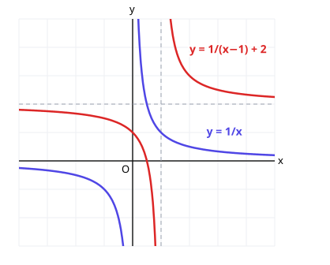
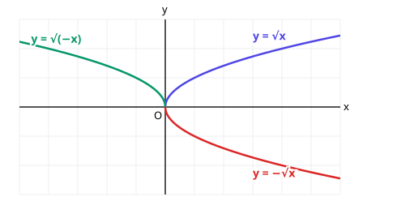

# 8. 유리함수와 무리함수

> **먼저 알아야 할 것**: [4. 도형의 이동](04-transformations.md), [7. 함수와 합성함수, 역함수](07-functions.md)
>
> **한 줄 요약**: $y = \dfrac{k}{x}$와 $y = \sqrt{x}$ 두 기본 모양을 알고, 평행이동으로 옮기면 끝입니다.

## 1. 유리함수: 분수 꼴 함수

$y = \dfrac{1}{x}$, $y = \dfrac{2x + 1}{x - 1}$처럼 $x$가 **분모에 있는** 함수를 유리함수라고 합니다.

### 기본형 $y = \dfrac{k}{x}$

중학교에서 배운 **반비례** 그래프입니다. $x$가 커지면 $y$는 작아지지요.

- 정의역: $x \neq 0$ (0으로 나눌 수 없으니까)
- 치역: $y \neq 0$
- 그래프가 한없이 가까워지지만 만나지 않는 직선 **점근선**: $x = 0$ ($y$축), $y = 0$ ($x$축)
- $k > 0$이면 1, 3사분면, $k < 0$이면 2, 4사분면에 그려짐

### 평행이동: $y = \dfrac{k}{x - p} + q$

$y = \dfrac{k}{x}$를 $x$축 방향으로 $p$, $y$축 방향으로 $q$만큼 평행이동한 것입니다.

- 점근선: $x = p$, $y = q$
- 정의역: $x \neq p$, 치역: $y \neq q$

위 그림의 빨간 그래프 $y = \dfrac{1}{x - 1} + 2$는 점근선이 $x = 1$, $y = 2$ (점선)입니다.

### $y = \dfrac{ax + b}{cx + d}$ 꼴은 나눗셈으로

$$
y = \frac{2x + 1}{x - 1} = \frac{2(x - 1) + 3}{x - 1} = \frac{3}{x - 1} + 2
$$

분자를 분모로 나눠서 "몫 + 나머지/분모" 꼴로 바꾸면 점근선이 보입니다. 점근선 $x = 1$, $y = 2$

> 💡 **빠른 확인**: $y = \dfrac{ax + b}{cx + d}$의 점근선은 분모가 0이 되는 $x = -\dfrac{d}{c}$와, $x$의 계수 비 $y = \dfrac{a}{c}$입니다.

## 2. 무리함수: 루트 꼴 함수

$y = \sqrt{x}$, $y = \sqrt{2x - 4} + 1$처럼 **루트 안에 $x$가 있는** 함수를 무리함수라고 합니다.

### 기본형 $y = \sqrt{x}$

| $x$ | $0$ | $1$ | $4$ | $9$ |
|---|---|---|---|---|
| $y$ | $0$ | $1$ | $2$ | $3$ |

- 정의역: $x \ge 0$ (루트 안은 0 이상이어야 하니까)
- 치역: $y \ge 0$
- 원점에서 출발해서 점점 완만하게 올라가는 반쪽 포물선 모양

$y = \sqrt{x}$는 $y = x^2$ ($x \ge 0$)의 **역함수**입니다. 그래서 두 그래프는 $y = x$에 대칭이에요.

### 대칭이동

- $y = -\sqrt{x}$: $x$축 대칭 (아래로)
- $y = \sqrt{-x}$: $y$축 대칭 (왼쪽으로), 정의역 $x \le 0$
- $y = -\sqrt{-x}$: 원점 대칭

### 평행이동: $y = \sqrt{a(x - p)} + q$

$y = \sqrt{ax}$를 $(p, q)$만큼 평행이동한 것으로, 그래프가 **점 $(p, q)$에서 출발**합니다.

**예)** $y = \sqrt{2x - 4} + 1 = \sqrt{2(x - 2)} + 1$

출발점 $(2, 1)$, 정의역 $x \ge 2$, 치역 $y \ge 1$

> 💡 루트 안을 $a(x - p)$ 꼴로 **묶어 주는 것**을 잊지 마세요. $\sqrt{2x - 4}$를 보고 $x$축 방향으로 4만큼 이동했다고 하면 틀립니다.

## 예제

**예제 1.** $y = \dfrac{3}{x + 2} - 1$의 점근선과 정의역은?

> 풀이: $x - (-2)$이므로 점근선 $x = -2$, $y = -1$. 정의역 $x \neq -2$

**예제 2.** $y = \dfrac{3x - 1}{x - 1}$의 점근선은?

> 풀이: $\dfrac{3(x - 1) + 2}{x - 1} = \dfrac{2}{x - 1} + 3$ → 점근선 $x = 1$, $y = 3$

**예제 3.** $y = -\sqrt{x + 3} + 2$의 정의역, 치역은?

> 풀이: $x + 3 \ge 0$ → 정의역 $x \ge -3$. 루트 앞이 마이너스라 아래로 내려가므로 치역 $y \le 2$

## 연습문제

1. $y = \dfrac{2}{x}$의 그래프는 몇 사분면에 있나요?
2. $y = \dfrac{1}{x - 3} + 4$의 점근선
3. $y = \dfrac{x + 5}{x + 1}$의 점근선
4. $y = \sqrt{x - 1} + 2$의 정의역, 치역, 출발점
5. $y = \sqrt{3x + 6}$의 정의역
6. $y = \sqrt{x}$의 그래프를 $x$축 방향으로 $-2$, $y$축 방향으로 $3$만큼 평행이동한 식

## 정답과 풀이

1. 1사분면과 3사분면 ($k = 2 > 0$)
2. $x = 3$, $y = 4$
3. $x = -1$, $y = 1$ ($\dfrac{(x + 1) + 4}{x + 1} = \dfrac{4}{x + 1} + 1$)
4. 정의역 $x \ge 1$, 치역 $y \ge 2$, 출발점 $(1, 2)$
5. $x \ge -2$ ($3x + 6 \ge 0$)
6. $y = \sqrt{x + 2} + 3$

---

이전 단원: [7. 함수와 합성함수, 역함수](07-functions.md) · 다음 단원: [대수 - 1. 지수](../algebra/01-exponents.md)

> 🎉 **공통수학2 완료!** 여기까지 오면 고등학교 1학년 수학을 모두 마친 것입니다.
