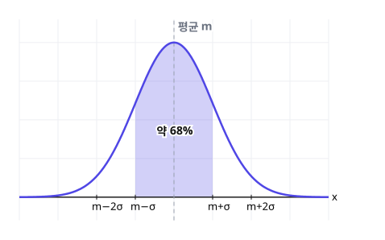

# 4. 확률분포

> **먼저 알아야 할 것**: [3. 조건부확률](03-conditional-probability.md) (독립시행)
>
> **한 줄 요약**: 확률분포는 "어떤 값이 몇 % 확률로 나오나"를 정리한 표이고, 평균(기댓값)은 "확률을 반영한 평균"입니다.

## 1. 확률변수와 확률분포

동전 2개를 던질 때 앞면의 개수를 $X$라고 합시다. $X$는 $0, 1, 2$ 중 하나이고 각각의 확률이 정해져 있습니다. 이런 $X$를 **확률변수**라고 합니다.

| $X$ | $0$ | $1$ | $2$ | 합계 |
|---|---|---|---|---|
| $P(X = x)$ | $\dfrac{1}{4}$ | $\dfrac{2}{4}$ | $\dfrac{1}{4}$ | $1$ |

이 표가 **확률분포**입니다. 확률을 모두 더하면 항상 $1$이에요.

> 💡 $X$처럼 셀 수 있는 값만 갖는 것을 **이산확률변수**, 키나 몸무게처럼 연속적인 값을 갖는 것을 **연속확률변수**라고 합니다.

## 2. 기댓값(평균), 분산, 표준편차

### 기댓값 $E(X)$: 확률을 반영한 평균

$$
E(X) = \sum x_i\,p_i = x_1 p_1 + x_2 p_2 + \cdots + x_n p_n
$$

> 💡 "**값 × 확률**을 모두 더한다." 여러 번 반복했을 때 평균적으로 기대되는 값입니다.

위의 동전 예: $E(X) = 0 \times \dfrac{1}{4} + 1 \times \dfrac{2}{4} + 2 \times \dfrac{1}{4} = 1$

동전 2개를 던지면 평균적으로 앞면이 1개 나온다는 뜻이지요.

**예)** 복권 1000장 중 1등(10만 원) 1장, 2등(1만 원) 10장이 있을 때, 한 장의 기댓값은

$$
100000 \times \frac{1}{1000} + 10000 \times \frac{10}{1000} + 0 \times \frac{989}{1000} = 100 + 100 = 200\text{원}
$$

이 복권이 1000원이라면 평균적으로 800원을 손해 보는 셈입니다.

### 분산 $V(X)$와 표준편차 $\sigma(X)$: 흩어진 정도

값들이 평균에서 얼마나 **퍼져 있는지** 나타냅니다.

$$
V(X) = E(X^2) - \{E(X)\}^2, \qquad \sigma(X) = \sqrt{V(X)}
$$

> 💡 "**제곱의 평균 − 평균의 제곱**"

동전 예: $E(X^2) = 0 \times \dfrac{1}{4} + 1 \times \dfrac{2}{4} + 4 \times \dfrac{1}{4} = \dfrac{3}{2}$

$V(X) = \dfrac{3}{2} - 1^2 = \dfrac{1}{2}$, $\sigma(X) = \dfrac{1}{\sqrt{2}} = \dfrac{\sqrt{2}}{2}$

### $aX + b$의 평균과 분산

$$
E(aX + b) = aE(X) + b, \qquad V(aX + b) = a^2 V(X), \qquad \sigma(aX + b) = |a|\,\sigma(X)
$$

모든 값에 $b$를 더하면 평균은 $b$만큼 옮겨지지만 **퍼진 정도는 그대로**입니다. 그래서 분산에는 $b$가 없어요.

## 3. 이항분포

[독립시행](03-conditional-probability.md)을 $n$번 할 때, 확률 $p$인 사건이 일어나는 횟수 $X$의 분포를 **이항분포** $B(n, p)$라고 합니다.

$$
P(X = r) = {}_n\mathrm{C}_r\,p^r(1 - p)^{n - r}
$$

이항분포는 평균과 분산이 아주 간단합니다.

$$
E(X) = np, \qquad V(X) = np(1 - p)
$$

예) 주사위를 60번 던져 1의 눈이 나오는 횟수 $X$: $B\left(60, \dfrac{1}{6}\right)$

$E(X) = 60 \times \dfrac{1}{6} = 10$, $V(X) = 60 \times \dfrac{1}{6} \times \dfrac{5}{6} = \dfrac{25}{3}$

> 💡 60번 던지면 1이 평균 10번 나온다. 직관 그대로죠?

## 4. 정규분포

키, 시험 점수처럼 많은 자료는 **평균 근처에 많이 모이고 멀어질수록 적어지는 종 모양**으로 분포합니다. 이것을 **정규분포** $N(m, \sigma^2)$이라고 합니다.

- $m$: 평균 (종의 중심)
- $\sigma$: 표준편차 (종이 얼마나 넓게 퍼졌나)
- 곡선은 평균 $m$을 기준으로 **좌우 대칭**
- 곡선 아래 전체 넓이 = $1$ (확률의 합)
- $P(a \le X \le b)$ = $a$부터 $b$까지 곡선 아래의 **넓이**

| 범위 | 확률 |
|---|---|
| $m - \sigma \le X \le m + \sigma$ | 약 $68\%$ |
| $m - 2\sigma \le X \le m + 2\sigma$ | 약 $95\%$ |
| $m - 3\sigma \le X \le m + 3\sigma$ | 약 $99.7\%$ |

### 표준화: 모든 정규분포를 하나로

평균과 표준편차가 제각각인 정규분포를 비교하려면, 평균 $0$, 표준편차 $1$인 **표준정규분포** $N(0, 1)$로 바꿉니다.

$$
Z = \frac{X - m}{\sigma}
$$

> 💡 $Z$는 "**평균에서 표준편차 몇 개만큼 떨어져 있나**"입니다. $Z = 2$면 평균보다 표준편차 2개만큼 높다는 뜻이에요.

그다음 **표준정규분포표**에서 $P(0 \le Z \le z)$ 값을 찾아 확률을 구합니다. 자주 쓰는 값은

| $z$ | $1$ | $1.5$ | $2$ | $2.5$ | $3$ |
|---|---|---|---|---|---|
| $P(0 \le Z \le z)$ | $0.3413$ | $0.4332$ | $0.4772$ | $0.4938$ | $0.4987$ |

**예)** 어느 시험 점수가 $N(70, 10^2)$을 따를 때, 90점 이상일 확률은?

$Z = \dfrac{90 - 70}{10} = 2$

$P(X \ge 90) = P(Z \ge 2) = 0.5 - P(0 \le Z \le 2) = 0.5 - 0.4772 = 0.0228$

약 $2.3\%$입니다. (오른쪽 절반의 넓이 $0.5$에서 $0$부터 $2$까지를 뺀 것)

> 💡 **정규분포 문제 풀이 순서**: ① $Z$로 바꾸기 ② 그림 그려서 구할 넓이 색칠 ③ 대칭과 $0.5$를 이용해 표의 값으로 계산

## 예제

**예제 1.** 확률분포가 다음과 같을 때 $a$와 $E(X)$

| $X$ | $1$ | $2$ | $3$ |
|---|---|---|---|
| $P$ | $\dfrac{1}{5}$ | $a$ | $\dfrac{2}{5}$ |

> 풀이: 합이 1이므로 $a = \dfrac{2}{5}$
>
> $E(X) = \dfrac{1}{5} + \dfrac{4}{5} + \dfrac{6}{5} = \dfrac{11}{5}$

**예제 2.** $X \sim B(100, 0.3)$일 때 평균과 표준편차

> 풀이: $E(X) = 30$, $V(X) = 100 \times 0.3 \times 0.7 = 21$, $\sigma = \sqrt{21}$

**예제 3.** $X \sim N(50, 4^2)$일 때 $P(46 \le X \le 56)$

> 풀이: $Z$로 바꾸면 $P(-1 \le Z \le 1.5) = 0.3413 + 0.4332 = 0.7745$

## 연습문제

1. 주사위 1개를 던져 나온 눈 $X$의 기댓값
2. 문제 1에서 $V(X)$ (힌트: $E(X^2) = \dfrac{91}{6}$)
3. $E(X) = 5$, $V(X) = 4$일 때 $E(3X - 2)$, $V(3X - 2)$, $\sigma(3X - 2)$
4. 동전을 400번 던질 때 앞면이 나오는 횟수의 평균과 표준편차
5. $X \sim N(60, 5^2)$일 때 $P(X \ge 65)$
6. $X \sim N(100, 10^2)$일 때 $P(85 \le X \le 120)$

## 정답과 풀이

1. $\dfrac{7}{2}$ ($\dfrac{1 + 2 + \cdots + 6}{6} = \dfrac{21}{6}$)
2. $\dfrac{35}{12}$ ($\dfrac{91}{6} - \dfrac{49}{4} = \dfrac{182 - 147}{12}$)
3. $13$, $36$, $6$
4. 평균 $200$, 표준편차 $10$ ($V = 400 \times \frac{1}{2} \times \frac{1}{2} = 100$)
5. $0.1587$ ($P(Z \ge 1) = 0.5 - 0.3413$)
6. $0.9104$ ($P(-1.5 \le Z \le 2) = 0.4332 + 0.4772$)

---

이전 단원: [3. 조건부확률](03-conditional-probability.md) · 다음 단원: [5. 통계적 추정](05-estimation.md)
